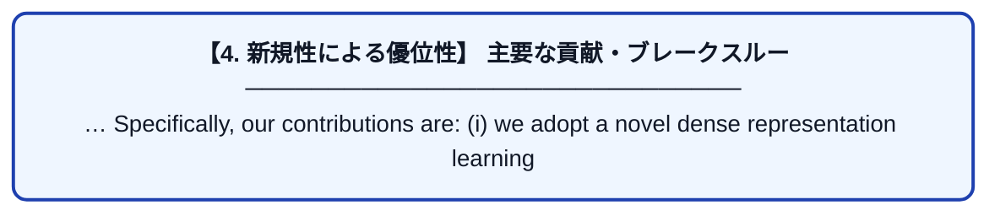

# Dense Representation Learning and Differentiable Shape Modeling for Spine Landmark Detection

| 項目 | 内容 |
|---|---|
| **著者** | A Daridon, S Sifaoui, A Assi, M Karam, W Skalli… |
| **掲載誌** | arXiv preprint arXiv … 2026 |
| **アラートキーワード** | representation learning |
| **PDF** | [https://arxiv.org/pdf/2610.36951](https://arxiv.org/pdf/2610.36951) |
| **Git リポジトリ** | [https://github.com/BioMedTP/Pix2Point](https://github.com/BioMedTP/Pix2Point) |
| **原文リンク** | [https://arxiv.org/pdf/2610.36951](https://arxiv.org/pdf/2610.36951) |
| **PDF版要約** | [README.pdf](./README.pdf) |

---

## 📊 新規性の図解（先行研究との違いと本研究のブレークスルー）

## 📝 要約

… Specifically, our contributions are: (i) we adopt a novel dense representation learning viewpoint on landmark detection, matching pixel embeddings with landmark prototypes to obtain landmark heatmaps; (ii) we integrate learnable spine …
