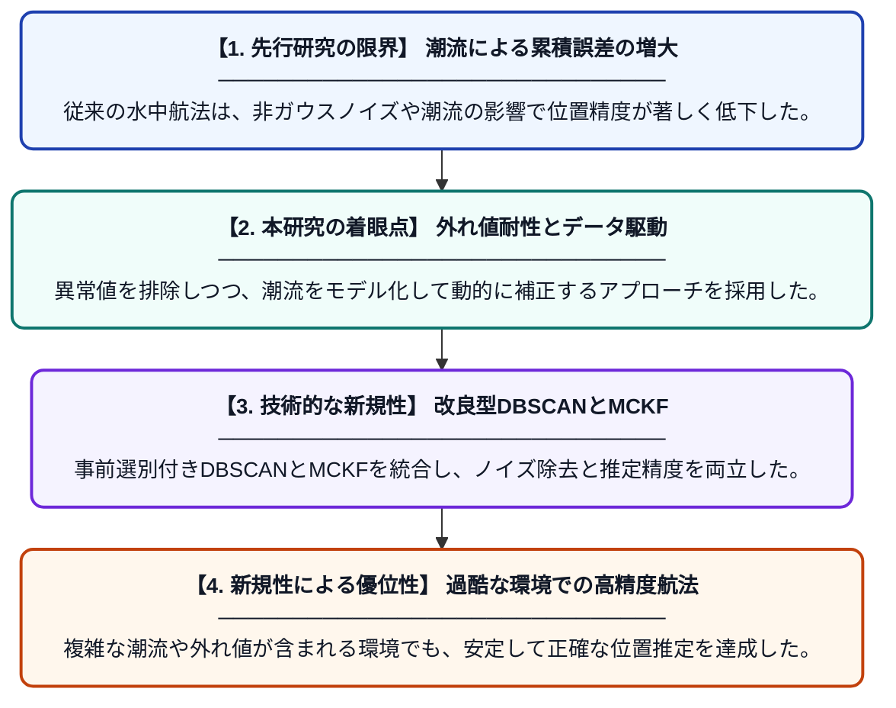

# OI-OGPR: SINS/WT-DVL航法のためのデータ駆動型かつ外れ値耐性を持つ潮流補正手法

**Original Title**: *OI-OGPR: A data-driven and outlier-tolerant water current compensation method for SINS/WT-DVL navigation*

> **💡 一言要約**: 外れ値に負けない高精度な水中潮流補正技術

| 項目 | 内容 |
|---|---|
| **著者** | Y Chen, Y Zhao, S Li, W Yao |
| **掲載誌** | IEEE Transactions on Instrumentation and … 2026 |
| **アラートキーワード** | kalman filter  "anomaly ... |
| **原文リンク** | [https://ieeexplore.ieee.org/abstract/document/11774951/](https://ieeexplore.ieee.org/abstract/document/11774951/) |
| **PDF版要約** | [README.pdf](./README.pdf) |

---

## 📊 新規性の図解（先行研究との違いと本研究のブレークスルー）

## 📝 要約

水中航法における大きな誤差要因である潮流を、データ駆動型アプローチで高精度に補正する手法を提案しています。外れ値に強い「最大相関エントロピーカルマンフィルタ（MCKF）」と改良された「DBSCAN」を組み合わせることで、ノイズの多い環境下でも安定した自己位置推定を可能にしました。

## ❓ どんな問題に取り組んだか

潜水機などの水中航行において、潮流は速度計測の大きな誤差要因となりますが、従来の補正手法は非ガウスノイズや突発的な外れ値に弱く、推定精度が低下する課題がありました。また、異常検知に使われるDBSCANアルゴリズムも、パラメータ設定の難しさから精度に限界がありました。

## ✨ 何が新しい？何がすごい？（新規性）

本研究の核心は、最大相関エントロピーカルマンフィルタ（MCKF）を採用して非ガウスノイズへの耐性を大幅に高めた点にあります。さらに、DBSCANによる異常検知の前に事前スクリーニングを導入し、ガウス過程回帰（GPR）を用いて潮流を動的にモデル化・補正する新しい枠組みを構築しました。これにより、先行研究では困難だった「外れ値除去」と「未知の潮流の学習」を同時に、かつ高精度に実現しています。

## 🎓 大学1年生向けの解説

水中を移動するロボットは、目印がないため「今どれくらいの速さで動いたか」を測って自分の位置を計算しますが、海水の流れ（潮流）のせいで計算が狂ってしまいます。この研究は、AIのような学習機能を使って潮流の影響を自動で修正する技術を開発しました。特に、データの中に紛れ込む「間違った値」を賢く見抜いて無視する工夫がされており、荒れた海の中でも正確に目的地へたどり着けるようになります。
