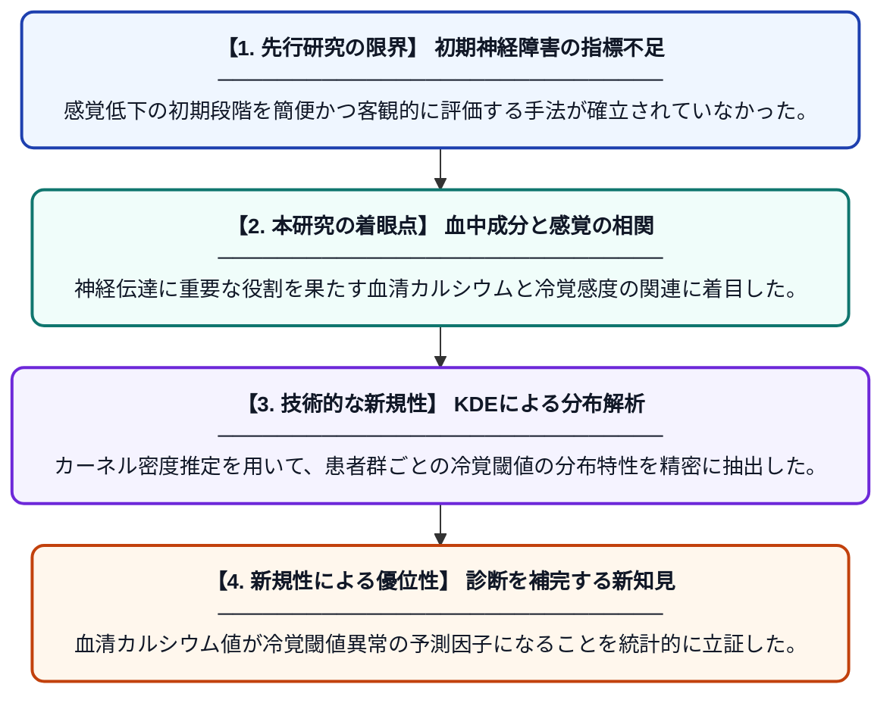

# 2型糖尿病患者における冷覚閾値の低下と血清カルシウム濃度の関連性

**Original Title**: *Association between impaired cold perception threshold and serum calcium in patients with type 2 diabetes mellitus*

> **💡 一言要約**: 冷たさを感じる鈍さは、血中カルシウム不足のサイン

| 項目 | 内容 |
|---|---|
| **著者** | Y Hao, Q Cui, L Qin, W Sun, S Zhou, Y Zhang, H Zheng… |
| **掲載誌** | Journal of Diabetes … 2026 |
| **アラートキーワード** | kernel density estimation |
| **原文リンク** | [https://pmc.ncbi.nlm.nih.gov/articles/PMC13743998/](https://pmc.ncbi.nlm.nih.gov/articles/PMC13743998/) |
| **PDF版要約** | [README.pdf](./README.pdf) |

---

## 📊 新規性の図解（先行研究との違いと本研究のブレークスルー）

## 📝 要約

2型糖尿病患者を対象に、冷たさを感じる能力（冷覚閾値）と血清カルシウム値の関連を調査した研究です。統計的な密度推定を用いた解析により、血清カルシウム値の低下が冷覚閾値の異常、つまり糖尿病性神経障害の初期兆候と密接に関わっていることが示されました。

## ❓ どんな問題に取り組んだか

糖尿病性神経障害は早期発見が重要ですが、初期の感覚低下を捉える客観的な指標は限られています。特に、神経機能の維持に不可欠なカルシウムイオンの血中濃度が、具体的な冷覚閾値の変動にどう影響しているかは詳しく分かっていませんでした。

## ✨ 何が新しい？何がすごい？（新規性）

この研究は、カーネル密度推定（KDE）を用いることで、糖尿病性神経障害の有無による冷覚閾値の分布の違いを精密に視覚化しました。血清カルシウム値が冷覚感知の感度に直接的な関連を持つことを大規模なデータで実証した点が最大の貢献です。これにより、血液検査という簡便な手法から神経障害のリスクを予測できる可能性を提示しました。

## 🎓 大学1年生向けの解説

糖尿病が悪化すると、手足の神経が鈍くなり、冷たさや痛みを感じにくくなる「神経障害」が起こります。この研究では、患者さんの「冷たさを感じる力」と「血液中のカルシウムの量」に深い関係があることを突き止めました。カルシウムが不足している人ほど、冷たさを感じるセンサーが鈍くなっている傾向があったのです。この発見により、血液検査の結果を見るだけで、神経の病気がどれくらい進んでいるかを予測できるようになるかもしれません。
