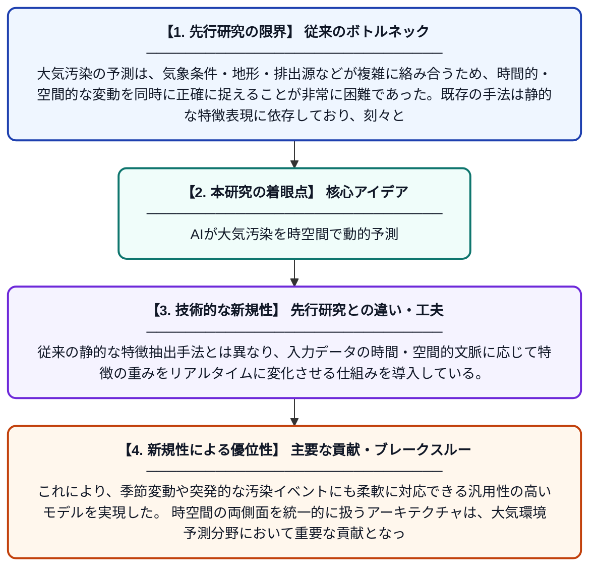

# 時空間大気汚染予測のための動的特徴適応型表現学習

**Original Title**: *Dynamic feature-adaptive representation learning for spatiotemporal air pollution forecasting*

> **💡 一言要約**: AIが大気汚染を時空間で動的予測

| 項目 | 内容 |
|---|---|
| **著者** | R Rana, N Kumar |
| **掲載誌** | Environmental Technology 2026 |
| **アラートキーワード** | representation learning |
| **原文リンク** | [https://www.tandfonline.com/doi/full/10.1080/09593330.2026.2692045](https://www.tandfonline.com/doi/full/10.1080/09593330.2026.2692045) |
| **PDF版要約** | [README.pdf](./README.pdf) |

---

## 📊 新規性の図解（先行研究との違いと本研究のブレークスルー）

## 📝 要約

本論文は、大気汚染の時空間的な予測精度を高めるために、動的に特徴を適応させる表現学習フレームワークを提案している。時間的・空間的な変動パターンを柔軟に捉えることで、従来手法では難しかった複雑な汚染物質の挙動を高精度にモデル化する。提案手法は、異なる地点・時間帯における汚染濃度の変化を動的に学習することで、より信頼性の高い予測を実現する。

## ❓ どんな問題に取り組んだか

大気汚染の予測は、気象条件・地形・排出源などが複雑に絡み合うため、時間的・空間的な変動を同時に正確に捉えることが非常に困難であった。既存の手法は静的な特徴表現に依存しており、刻々と変化する環境条件への適応が不十分であった。特に都市部など複数の汚染源が混在する環境では、予測精度の低下が深刻な課題となっていた。

## ✨ 何が新しい？何がすごい？（新規性）

本研究は、時空間情報を統合しながら特徴表現を動的に調整できる適応型学習フレームワークを新たに提案した点が最大の新規性である。従来の静的な特徴抽出手法とは異なり、入力データの時間・空間的文脈に応じて特徴の重みをリアルタイムに変化させる仕組みを導入している。これにより、季節変動や突発的な汚染イベントにも柔軟に対応できる汎用性の高いモデルを実現した。時空間の両側面を統一的に扱うアーキテクチャは、大気環境予測分野において重要な貢献となっている。

## 🎓 大学1年生向けの解説

私たちが毎日吸っている空気の汚染度（PM2.5などの大気汚染）は、場所や時間によって大きく変わります。この研究では、AIを使って「どこで・いつ・どのくらい空気が汚れるか」を予測するシステムを作りました。ポイントは、AIが状況に合わせて自分の学習方法を自動的に切り替える「動的な適応機能」を持っている点です。たとえば、朝の通勤ラッシュ時と夜中では汚染のパターンが違うため、それぞれに最適な予測ができます。このシステムにより、将来の大気汚染を事前に知ることができ、外出の判断や健康管理に役立てることが期待されます。
