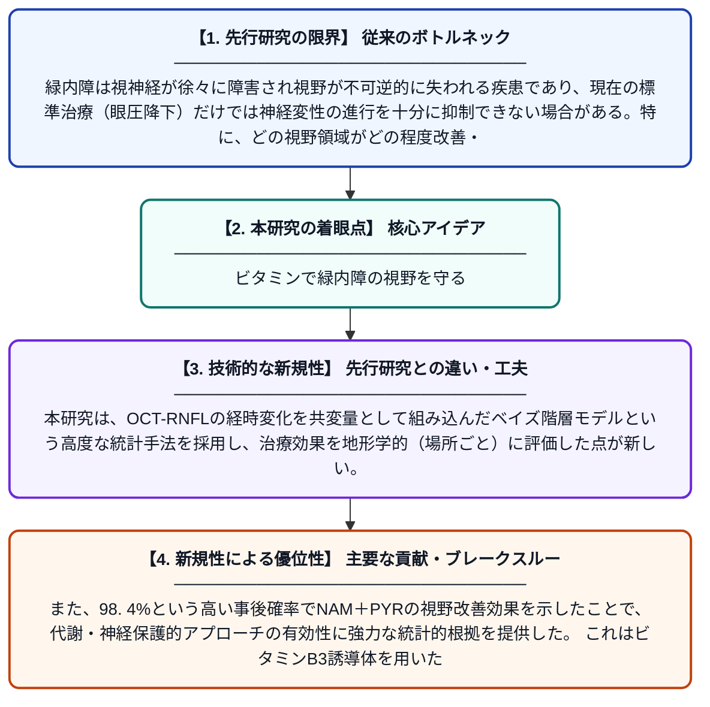

# 開放隅角緑内障に対するニコチンアミドとピルビン酸の第2相無作為化試験における視野改善の地形学的解析

**Original Title**: *A Topographical Analysis of Visual Field Improvement in a Phase 2 Randomized Trial of Nicotinamide and Pyruvate for Open-Angle Glaucoma*

> **💡 一言要約**: ビタミンで緑内障の視野を守る

| 項目 | 内容 |
|---|---|
| **著者** | CG De Moraes, AG Shukla, GA Cioffi, SWM John |
| **掲載誌** | Investigative Ophthalmology & Visual Science 2026 |
| **アラートキーワード** | Bayesian hierarchical ... |
| **原文リンク** | [https://pubmed.ncbi.nlm.nih.gov/42517851/](https://pubmed.ncbi.nlm.nih.gov/42517851/) |
| **PDF版要約** | [README.pdf](./README.pdf) |

---

## 📊 新規性の図解（先行研究との違いと本研究のブレークスルー）

## 📝 要約

本研究は、開放隅角緑内障患者を対象に、ニコチンアミド（NAM）とピルビン酸（PYR）の併用療法が視野に与える効果を、ベイズ統計モデルを用いて地形学的に詳細に解析した。光干渉断層計による網膜神経線維層の厚さ変化を共変量として組み込んだベイズ階層モデルにより、NAM＋PYR治療が視野を改善する事後確率が98.4%に達することが示された。この結果は、代謝サポートを通じた神経保護療法が緑内障の新たな治療選択肢となりうることを示唆している。

## ❓ どんな問題に取り組んだか

緑内障は視神経が徐々に障害され視野が不可逆的に失われる疾患であり、現在の標準治療（眼圧降下）だけでは神経変性の進行を十分に抑制できない場合がある。特に、どの視野領域がどの程度改善・悪化するかを定量的・空間的に評価する手法が不足しており、神経保護薬の効果を正確に判定することが難しかった。

## ✨ 何が新しい？何がすごい？（新規性）

先行研究では緑内障治療薬の評価に平均的な視野指標が用いられることが多く、視野上の空間的パターンを考慮した解析は限られていた。本研究は、OCT-RNFLの経時変化を共変量として組み込んだベイズ階層モデルという高度な統計手法を採用し、治療効果を地形学的（場所ごと）に評価した点が新しい。また、98.4%という高い事後確率でNAM＋PYRの視野改善効果を示したことで、代謝・神経保護的アプローチの有効性に強力な統計的根拠を提供した。これはビタミンB3誘導体を用いた神経保護療法の臨床的有用性を支持する重要なエビデンスとなる。

## 🎓 大学1年生向けの解説

緑内障は目の神経が少しずつ壊れていき、視野（見える範囲）が狭くなっていく病気です。この研究では、ニコチンアミド（ビタミンB3の仲間）とピルビン酸（体のエネルギー源となる物質）を一緒に飲むと、視野が改善するかどうかを調べました。「ベイズ統計」という高度な数学的手法を使って、どの場所の視野がどれくらい良くなったかを地図のように詳しく分析した結果、約98%の確率でこの治療が視野を改善することがわかりました。つまり、目薬で眼圧を下げるだけでなく、栄養素で神経自体を守る新しい治療法の可能性を示した研究です。
