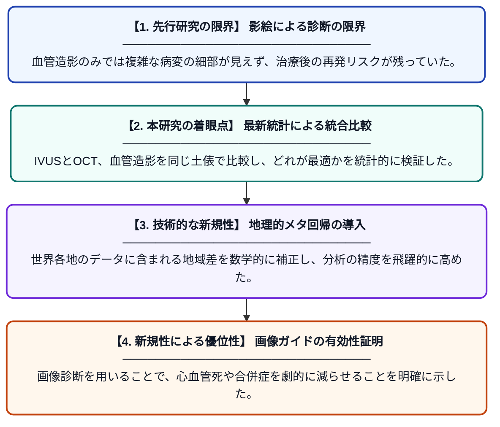

# 複雑な冠動脈病変における画像ガイド下対血管造影ガイド下PCI：地理的メタ回帰を用いた最新のベイズ・ネットワーク・メタ解析

**Original Title**: *… Imaging-versus Angiography-Guided Percutaneous Coronary Intervention in Complex Coronary Lesions: An Updated Bayesian Network Meta-Analysis with …*

> **💡 一言要約**: 心臓の複雑な治療は「目」で見て治すのが正解

| 項目 | 内容 |
|---|---|
| **著者** | R Falodia, MJ Azhar, E Alokozay, U Irshad, SJ Malik… |
| **掲載誌** | Journal of the American … 2026 |
| **アラートキーワード** | bayesian network |
| **原文リンク** | [https://www.jacc.org/doi/full/10.1016/j.jacc.2026.09.1203](https://www.jacc.org/doi/full/10.1016/j.jacc.2026.09.1203) |
| **PDF版要約** | [README.pdf](./README.pdf) |

---

## 📊 新規性の図解（先行研究との違いと本研究のブレークスルー）

## 📝 要約

複雑な冠動脈病変に対するPCI（カテーテル治療）において、IVUSやOCTといった画像診断装置を用いることの有効性を、最新の臨床試験データに基づきベイズ・ネットワーク・メタ解析で検証しました。その結果、従来の血管造影のみに頼る手法と比較して、画像ガイド下の治療が心血管イベントのリスクを大幅に低減させることが示されました。

## ❓ どんな問題に取り組んだか

心臓の血管が複雑に詰まっている場合、従来のレントゲン（血管造影）だけでは血管内部の状態を十分に把握できず、治療後の再発や合併症が起こりやすいという課題がありました。IVUS（超音波）やOCT（光）といった画像診断の有用性は知られていましたが、それらを網羅的に比較した最新の証拠が求められていました。

## ✨ 何が新しい？何がすごい？（新規性）

本研究は、最新のランダム化比較試験を統合し、ベイズ・ネットワーク・メタ解析を用いることで、IVUSとOCT、そして血管造影の優劣を精密に比較しました。さらに「地理的メタ回帰」という手法を導入し、世界の地域ごとの治療背景の違いを統計的に調整して、より普遍的で信頼性の高いエビデンスを導き出しています。これにより、複雑病変に対する画像ガイド下PCIの優位性を決定づけました。

## 🎓 大学1年生向けの解説

心臓の血管を広げる治療では、これまで「影絵」のようなレントゲン写真を見ながら作業してきました。しかし、最近は血管の中から超音波や光を使って、内部を詳しく「見る」技術が発達しています。この研究は、世界中のデータを最新の数学的な方法で分析し、しっかり中を見て治療する方が、影絵だけでやるよりも患者さんがずっと元気でいられることを証明しました。これにより、これからの心臓治療の新しいルールが作られようとしています。
