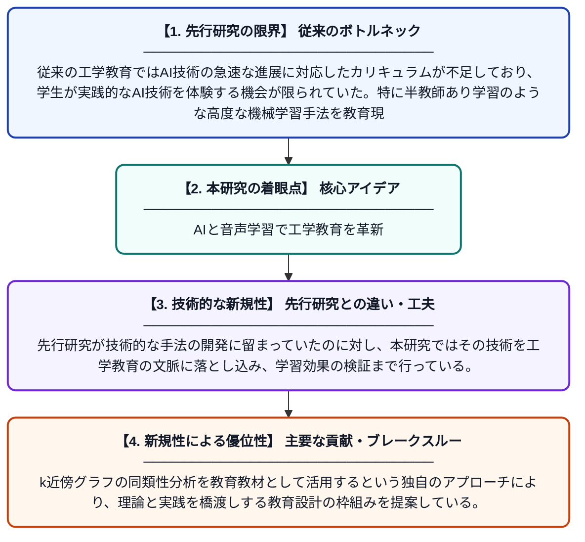

# プロジェクト型学習によるAI統合工学教育：離散音声ユニットの半教師あり表現学習に関するケーススタディ

**Original Title**: *Teaching AI-Integrated Engineering Through Project-Based Learning: A Case Study on Semi-Supervised Representation Learning for Discrete Audio Unit …*

> **💡 一言要約**: AIと音声学習で工学教育を革新

| 項目 | 内容 |
|---|---|
| **著者** | HN Beesabathuni |
| **掲載誌** | Journal of Engineering Education Transformations 2026 |
| **アラートキーワード** | manifold learning |
| **PDF** | [https://journaleet.in/index.php/jeet/article/download/4784/2605](https://journaleet.in/index.php/jeet/article/download/4784/2605) |
| **原文リンク** | [https://journaleet.in/index.php/jeet/article/download/4784/2605](https://journaleet.in/index.php/jeet/article/download/4784/2605) |
| **PDF版要約** | [README.pdf](./README.pdf) |

---

## 📊 新規性の図解（先行研究との違いと本研究のブレークスルー）

## 📝 要約

本論文は、AIを組み込んだ工学教育をプロジェクト型学習（PBL）で実践した事例研究であり、音声データの効率的な表現学習を教材として活用している。多様体学習を用いて音声の識別性の高いコンパクトな表現を学習する手法を核とし、高次元データのk近傍グラフにおける同類性（アソータティビティ）の研究とも関連付けている。AIの理論と実践を融合させた教育カリキュラムの設計・効果の両面について考察している。

## ❓ どんな問題に取り組んだか

従来の工学教育ではAI技術の急速な進展に対応したカリキュラムが不足しており、学生が実践的なAI技術を体験する機会が限られていた。特に半教師あり学習のような高度な機械学習手法を教育現場に効果的に取り入れる方法論が確立されていなかった。

## ✨ 何が新しい？何がすごい？（新規性）

本研究は、半教師あり表現学習と多様体学習を組み合わせた音声処理タスクを教育プロジェクトとして設計した点が新しい。先行研究が技術的な手法の開発に留まっていたのに対し、本研究ではその技術を工学教育の文脈に落とし込み、学習効果の検証まで行っている。k近傍グラフの同類性分析を教育教材として活用するという独自のアプローチにより、理論と実践を橋渡しする教育設計の枠組みを提案している。

## 🎓 大学1年生向けの解説

AIは今や多くの場面で使われていますが、それを大学の授業でどう教えるかは大きな課題です。この研究では、「音声データをコンピュータに賢く学ばせる」という実際のAIプロジェクトを通じて、学生がAI技術をハンズオンで学べる授業の仕組みを作りました。少ないラベル付きデータからでも音声の特徴を上手に学習する「半教師あり学習」という手法を題材にしています。プロジェクトをこなすことで、学生はAIの理論だけでなく実践的なスキルも身につけられます。
