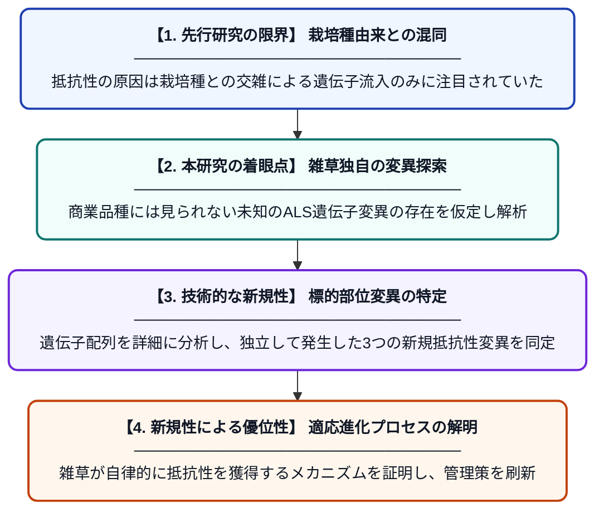

# 雑草イネにおける反復的な遺伝子流動の遺産とALS阻害剤抵抗性変異の独立した進化の証拠

**Original Title**: *Legacy of Recurrent Gene Flow and Evidence of Independent Evolution of ALS Resistance Mutations in Weedy Rice*

> **💡 一言要約**: 雑草イネは独自進化で除草剤を克服する：驚異の適応力

| 項目 | 内容 |
|---|---|
| **著者** | GM Turra, PS Angonese, EC Rudell, VF Tasca… |
| **掲載誌** | Evolutionary Applications 2026 |
| **アラートキーワード** | ALS |
| **PDF** | [https://onlinelibrary.wiley.com/doi/pdf/10.1111/eva.70342](https://onlinelibrary.wiley.com/doi/pdf/10.1111/eva.70342) |
| **原文リンク** | [https://onlinelibrary.wiley.com/doi/pdf/10.1111/eva.70342](https://onlinelibrary.wiley.com/doi/pdf/10.1111/eva.70342) |
| **PDF版要約** | [README.pdf](./README.pdf) |

---

## 📊 新規性の図解（先行研究との違いと本研究のブレークスルー）

## 📝 要約

本研究は、除草剤（ALS阻害剤）に抵抗性を持つ雑草イネの進化過程を遺伝学的に分析しました。商用の抵抗性栽培イネに由来しない独自の突然変異を特定し、雑草イネが環境適応のために独立して抵抗性を進化させている実態を明らかにしました。

## ❓ どんな問題に取り組んだか

農作物の成長を阻害する雑草イネが除草剤への抵抗性を獲得していますが、その起源が栽培イネからの遺伝子流入なのか、雑草独自の進化なのかは不明でした。この発生源の特定は、効果的な雑草管理と除草剤の持続的な利用を計画する上で極めて重要な課題です。

## ✨ 何が新しい？何がすごい？（新規性）

商用の抵抗性品種には存在しないALS遺伝子の特定の変異（Ala205Val、Trp574Leu、Ser653Thr）を雑草イネから発見した点が最大の貢献です。これは、栽培種からの「お下がり」の遺伝子だけでなく、強い除草剤の選択圧によって雑草イネが自ら新たな耐性を獲得する「独立進化」が起きていることを証明しました。特にTrp574Leu変異が広範な除草剤への交差抵抗性を持つことを示した点は、現場の防除戦略に一石を投じるものです。

## 🎓 大学1年生向けの解説

田んぼに生える「雑草イネ」は、私たちが食べるお米の成長を邪魔する困った存在です。農家さんは除草剤でこれらを退治しようとしますが、最近では薬が効かない「スーパー雑草イネ」が増えて問題になっています。この研究は、その強さの秘密が人間が改良したお米から遺伝子をもらっただけでなく、雑草自らが独自に遺伝子を変化させて生き延びていることを突き止めました。植物が厳しい環境で生き残ろうとする、たくましくも恐ろしい進化の力を示した研究です。
