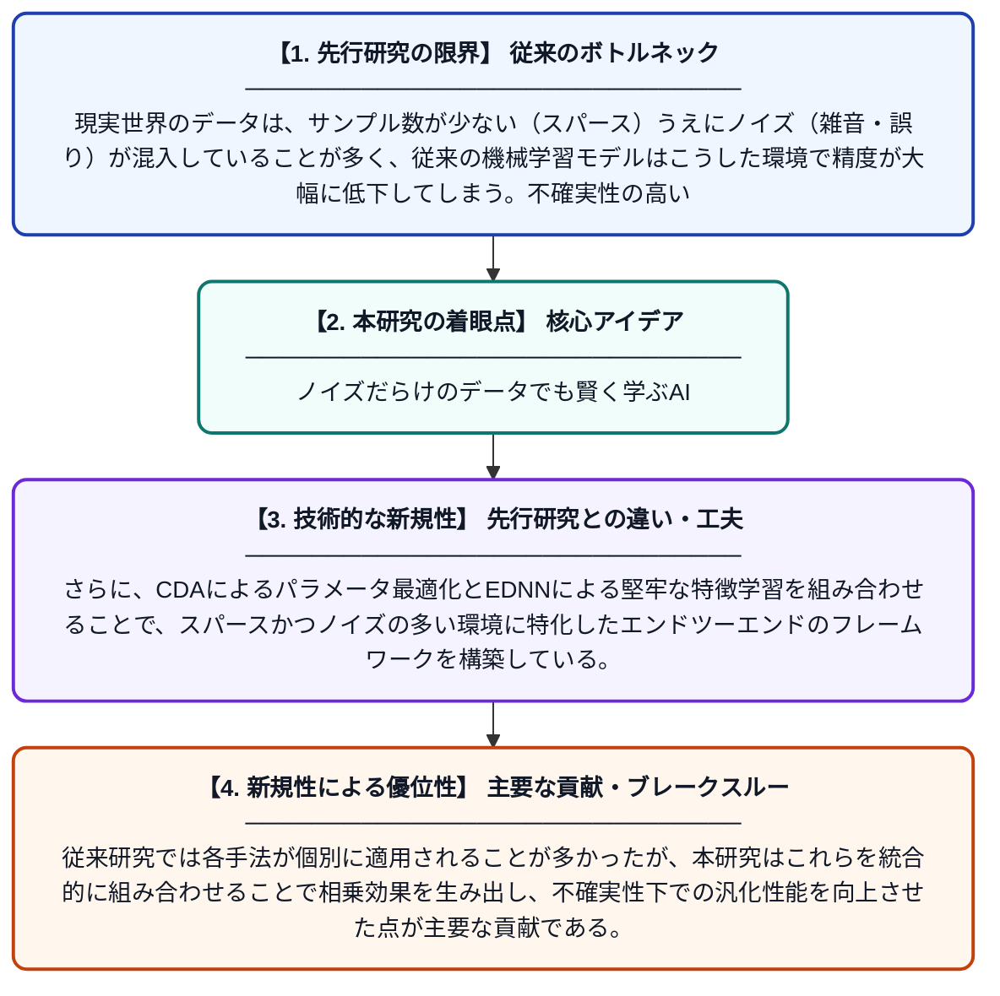

# スパースかつノイズの多いデータ環境における不確実性下での学習

**Original Title**: *Learning Under Uncertainty in Sparse and Noisy Data Environments*

> **💡 一言要約**: ノイズだらけのデータでも賢く学ぶAI

| 項目 | 内容 |
|---|---|
| **著者** | A Yasodai, D Sharma, K Mundada, P Rahate |
| **掲載誌** | International Journal of AI and Machine Learning 2026 |
| **アラートキーワード** | independent component ... |
| **PDF** | [https://www.svedbergopen.com/index.php/ijaiml/article/download/595/456](https://www.svedbergopen.com/index.php/ijaiml/article/download/595/456) |
| **原文リンク** | [https://www.svedbergopen.com/index.php/ijaiml/article/download/595/456](https://www.svedbergopen.com/index.php/ijaiml/article/download/595/456) |
| **PDF版要約** | [README.pdf](./README.pdf) |

---

## 📊 新規性の図解（先行研究との違いと本研究のブレークスルー）

## 📝 要約

本論文は、データが少なく・ノイズが多い環境での機械学習の精度向上を目的とし、独立成分分析（ICA）による特徴抽出と、CDA（収束的差分アルゴリズム）およびEDNN（拡張深層ニューラルネットワーク）を組み合わせた手法を提案する。ICAにより潜在的な信号源を分離して信号表現を強化し、CDAがネットワークパラメータを最適化することで、EDNNが堅牢な特徴パターンを学習できるよう設計されている。これにより、不確実性の高い現実的なデータ環境においても高い汎化性能を実現することを目指している。

## ❓ どんな問題に取り組んだか

現実世界のデータは、サンプル数が少ない（スパース）うえにノイズ（雑音・誤り）が混入していることが多く、従来の機械学習モデルはこうした環境で精度が大幅に低下してしまう。不確実性の高いデータ環境でも安定して正確な学習・予測を行う手法の確立が急務となっている。

## ✨ 何が新しい？何がすごい？（新規性）

ICAを用いた特徴抽出により、ノイズ混じりのデータから本質的な潜在信号を分離するという前処理戦略を導入した点が新しい。さらに、CDAによるパラメータ最適化とEDNNによる堅牢な特徴学習を組み合わせることで、スパースかつノイズの多い環境に特化したエンドツーエンドのフレームワークを構築している。従来研究では各手法が個別に適用されることが多かったが、本研究はこれらを統合的に組み合わせることで相乗効果を生み出し、不確実性下での汎化性能を向上させた点が主要な貢献である。

## 🎓 大学1年生向けの解説

AIはたくさんのデータから学習しますが、データが少なかったり、間違いだらけだったりすると、うまく学べません。この研究では、まず「独立成分分析（ICA）」という技術でノイズの中から本当に大切な情報だけを取り出します。次に、特別なアルゴリズム（CDAとEDNN）を使ってAIが少ないデータでも正確に学習できるよう工夫しています。まるで、雑音だらけのラジオから声だけをきれいに聞き取るような技術です。これにより、医療や金融など「データが少なくてノイズが多い」場面でも、AIが信頼性高く動作することを目指しています。
