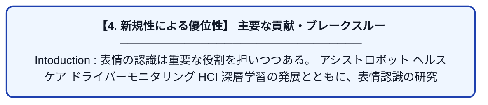

# Bridging the gap in FER: addressing age bias in deep learning

| 項目 | 内容 |
|---|---|
| **PDF版要約** | [README.pdf](./README.pdf) |

---

## 📊 新規性の図解（先行研究との違いと本研究のブレークスルー）

## 📝 要約

Intoduction :

表情の認識は重要な役割を担いつつある。

アシストロボット

ヘルスケア

ドライバーモニタリング

HCI

深層学習の発展とともに、表情認識の研究もより発展してきた。

深層学習の技術は大量のデータに依存している。

しかし、そのデータセットはバイアスを含んでいることが多い。

子供や高齢者は少数派になりやすい。

高齢者の顔の形態学的側面も高齢者と若者では違う。

このような問題に対処するために、研究者たちは説明可能AIに取り組み始めた。

それは深層学習の意思決定の過程を解釈するのに重要なツールを与えます。

こうしたバイアスを緩和する三つの方法を開発した。

Multi-task Learning,

Multi-modal Input,

Age-weighted Loss

AffectNetを使って検証した。

使ったデータセットはこれら。

FACES [14],

RaFD [38],

and DDCF [10].

2. Related work

様々な研究が、年齢が表情認識に与える影響について調査してきたよ。

高齢者においては、特定の表情が若年者よりも識別しづらい

Fölster et al. [18]らが、シワやたるみなどの年齢に関わる変化が表情の認識に大きく影響することを示した。

異なる年齢層から集めたデータセットでFERを訓練した。

高齢者では表情の認識が難しいことを示した。

Their study showed that training models on age-specific datasets led to a 22% increase in accuracy compared to training on datasets that did not account for age differences.

年齢差を考慮したデータセットで訓練する方が、考慮しないデータセットで訓練したモデルより精度がよかった。

表情認識が広く研究されているので、年齢による偏りを緩和することを目的とした研究がいくつもされています。

年齢を明示的な特徴量として扱う

年齢による重みづけをして、形状や、きめ、その他見た目の特徴量と使い年齢に特化したモデルを学習する

顔の主要な構造は残しつつ、顔を平滑化するアプローチ

年齢と表情を同時に予測するマルチタスクのアプローチ(共有された中間表現を使用して)

年齢の分類をパイプラインに組み込むアプローチ

FACES,

LifeSpan,

and NEMO

研究テーマ

データセットの構造

XAI tools

LIME

Training

Yolov8

SPIGA

Approaches facing age biases

年齢ごと、表情ごとの重みづけ

4.5.2. Multi-task Learning

マルチタスクの状況設定において、対象者の年齢と表情の認識は密接に関連していると仮定している。

なので、表情と年齢を同時に推定することにした。

表情の認識と年齢の推定を同時に行うことで、特徴量を共有できる。

MSEに不均衡データの場合の重みづけ用があるらしい。

,we applied density-based weighting [59] to the MSE loss, a technique
well-suited for imbalanced regression.

4.5.3. Multi-modal Input

Discussion

Future work

今回検証したバイアス緩和手法の他の分野への適用

認証技術やHCI
