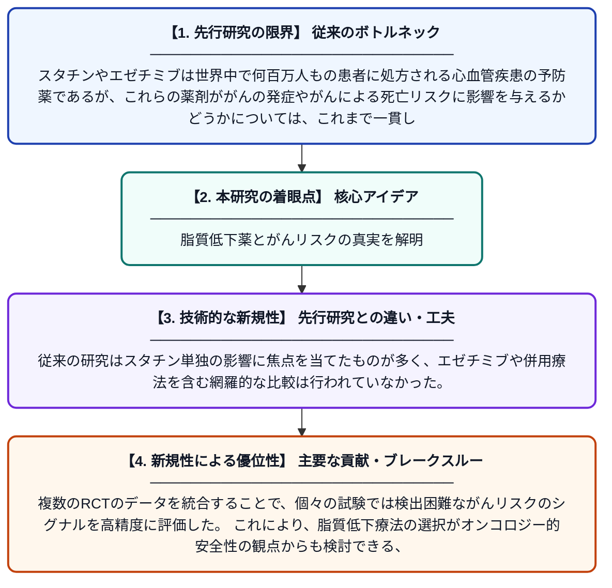

# スタチン療法、エゼチミブ、およびスタチン・エゼチミブ併用療法とがん発症率・がん関連死亡率との関連性：ランダム化比較試験のシステマティックレビューおよびベイズネットワークメタ解析

**Original Title**: *Association of Cancer Incidence and Cancer-Related Mortality with Statin Therapy, Ezetimibe, and Statin–Ezetimibe Combination-A Systematic Review and Bayesian Network Meta-analysis of Randomized Controlled Trials*

> **💡 一言要約**: 脂質低下薬とがんリスクの真実を解明

| 項目 | 内容 |
|---|---|
| **著者** | N Ghalib, M Tyagi, S Virani, K Maki, L Sperling |
| **掲載誌** | European Journal of Preventive Cardiology 2026 |
| **アラートキーワード** | bayesian network |
| **原文リンク** | [https://academic.oup.com/eurjpc/advance-article/doi/10.1093/eurjpc/zwag392/8746390](https://academic.oup.com/eurjpc/advance-article/doi/10.1093/eurjpc/zwag392/8746390) |
| **PDF版要約** | [README.pdf](./README.pdf) |

---

## 📊 新規性の図解（先行研究との違いと本研究のブレークスルー）

## 📝 要約

本研究では、スタチン単剤療法、エゼチミブ単剤療法、およびスタチン・エゼチミブ併用療法が、脂質低下療法なしと比較してがん発症率やがん関連死亡率に与える影響を、ランダム化比較試験のシステマティックレビューとベイズネットワークメタ解析によって検討した。これらの脂質低下薬は心血管疾患の予防薬として広く使用されているが、がんリスクへの影響については議論が続いていた。解析の結果、各治療法とがんリスクとの関連性について包括的な証拠がまとめられた。

## ❓ どんな問題に取り組んだか

スタチンやエゼチミブは世界中で何百万人もの患者に処方される心血管疾患の予防薬であるが、これらの薬剤ががんの発症やがんによる死亡リスクに影響を与えるかどうかについては、これまで一貫した結論が得られていなかった。個々の臨床試験では規模が小さく、がんという転帰を主要評価項目としていないものが多く、信頼性の高いエビデンスが不足していた。

## ✨ 何が新しい？何がすごい？（新規性）

本研究は、スタチン単剤・エゼチミブ単剤・スタチン＋エゼチミブ併用という複数の治療法を同時に比較できるベイズネットワークメタ解析という高度な統計手法を用いた点が新しい。従来の研究はスタチン単独の影響に焦点を当てたものが多く、エゼチミブや併用療法を含む網羅的な比較は行われていなかった。複数のRCTのデータを統合することで、個々の試験では検出困難ながんリスクのシグナルを高精度に評価した。これにより、脂質低下療法の選択がオンコロジー的安全性の観点からも検討できる、臨床的に重要な知見を提供している。

## 🎓 大学1年生向けの解説

スタチンやエゼチミブというのは、血液中の悪玉コレステロールを下げて心臓病を防ぐためのお薬です。これらのお薬はとても多くの人が飲んでいますが、「もしかしてがんのリスクを上げたり下げたりするのでは？」という疑問が長年ありました。この研究では、過去に行われた多くの臨床試験のデータを集めて、高度な統計手法で一気に比較・分析しました。複数の薬の組み合わせを同時に比較できる「ネットワークメタ解析」という方法を使うことで、より正確な答えを導き出そうとしたのです。この結果は、何百万人もの患者さんに処方されるお薬の安全性を考えるうえで、とても大切な情報となります。
