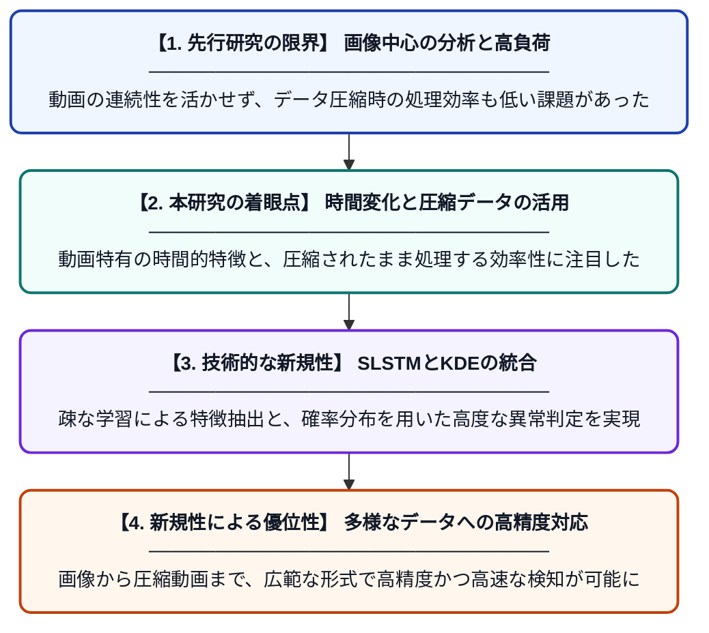

# 異常検知の包括的レビュー：画像から動画、および圧縮ビデオストリームまで

**Original Title**: *A comprehensive review of anomaly detection: from images to videos and compressed video streams*

> **💡 一言要約**: 画像から圧縮動画まで網羅する最新異常検知レビュー

| 項目 | 内容 |
|---|---|
| **著者** | N Manzoor, JI Bhat |
| **掲載誌** | Knowledge and Information Systems 2026 |
| **アラートキーワード** | sparse coding |
| **原文リンク** | [https://link.springer.com/article/10.1007/s10115-026-02923-x](https://link.springer.com/article/10.1007/s10115-026-02923-x) |
| **PDF版要約** | [README.pdf](./README.pdf) |

---

## 📊 新規性の図解（先行研究との違いと本研究のブレークスルー）

## 📝 要約

画像、動画、および圧縮されたビデオストリームにおける異常検知技術を網羅的に調査したレビュー論文です。Sparse LSTMやKDEを用いたデノイジングオートエンコーダなど、最新の深層学習手法の動向と課題を整理しています。

## ❓ どんな問題に取り組んだか

従来の異常検知は静止画像が中心で、動画特有の時間的な変化や、データ量の多い圧縮ストリームへの対応が不十分でした。複雑なデータから効率的に特徴を抽出するための統一的な知見と、計算コストの課題が残されていました。

## ✨ 何が新しい？何がすごい？（新規性）

本論文は画像から圧縮ビデオまでを体系的に整理し、Sparse LSTMによる効率的な時間特徴学習やKDEを用いた確率的判定の有効性を明示しました。単なる手法の列挙ではなく、計算負荷の高い圧縮データの直接処理にまで踏み込んだ点が特徴です。最新の深層学習技術を横断的に比較し、次世代の研究の方向性を具体的に示しています。

## 🎓 大学1年生向けの解説

監視カメラなどの映像から「いつもと違う動き」を自動で見つける技術についてのまとめです。写真だけでなく、動く映像やデータ量を小さくした動画でも正しく異常を見つけるための最新のAI技術を解説しています。難しい仕組みを整理して、AIがどのように「普通」と「異常」を区別するのかを分かりやすく教えてくれます。AIの研究が今どこまで進んでいるかを知るのにぴったりの内容です。
