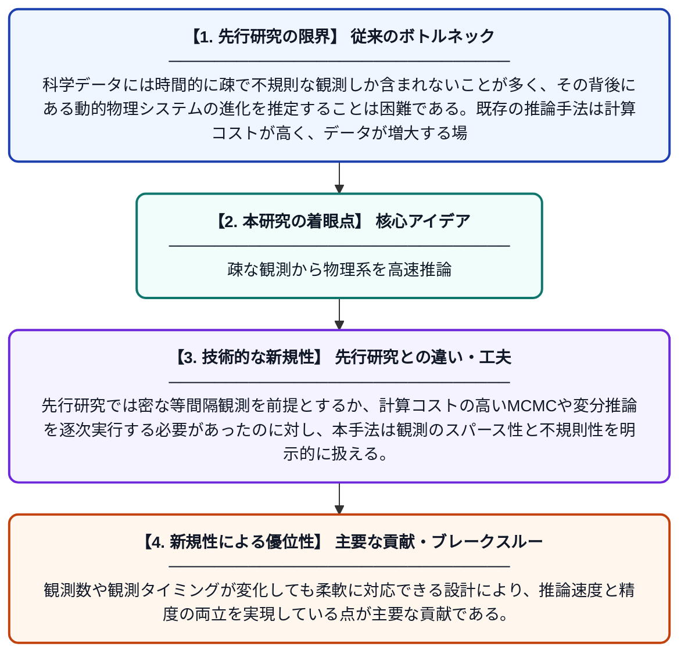

# 疎な時系列観測への注意機構を用いた高速推論学習

**Original Title**: *Learning to Infer Fast by Attending to Sparse Temporal Observations*

> **💡 一言要約**: 疎な観測から物理系を高速推論

| 項目 | 内容 |
|---|---|
| **著者** | M Motamed, H Bendekgey, D Sujono, EB Sudderth |
| **アラートキーワード** | Markov random"  fields |
| **PDF** | [https://ics.uci.edu/~sudderth/papers/uai26inferFast.pdf](https://ics.uci.edu/~sudderth/papers/uai26inferFast.pdf) |
| **原文リンク** | [https://ics.uci.edu/~sudderth/papers/uai26inferFast.pdf](https://ics.uci.edu/~sudderth/papers/uai26inferFast.pdf) |
| **PDF版要約** | [README.pdf](./README.pdf) |

---

## 📊 新規性の図解（先行研究との違いと本研究のブレークスルー）

## 📝 要約

本論文は、時間的に疎かつ不規則な観測データから動的システムの状態とパラメータを高速に推論する手法を提案する。注意機構（アテンション）を活用することで、観測が少ない・不規則なデータでも効率的に潜在的な物理システムの進化を推定できる。特に大規模・増大するデータセットに対してスケーラブルな推論を実現することを目指している。

## ❓ どんな問題に取り組んだか

科学データには時間的に疎で不規則な観測しか含まれないことが多く、その背後にある動的物理システムの進化を推定することは困難である。既存の推論手法は計算コストが高く、データが増大する場面でのリアルタイム推論には不向きであった。こうした設定でのパラメータ推定や状態予測を高速かつ正確に行う手法が求められていた。

## ✨ 何が新しい？何がすごい？（新規性）

本研究はアテンション機構を用いて、疎・不規則な時系列観測から動的システムの隠れ状態とパラメータを直接かつ高速に推論するニューラルネットワークベースのアモータイズド推論フレームワークを提案する。先行研究では密な等間隔観測を前提とするか、計算コストの高いMCMCや変分推論を逐次実行する必要があったのに対し、本手法は観測のスパース性と不規則性を明示的に扱える。観測数や観測タイミングが変化しても柔軟に対応できる設計により、推論速度と精度の両立を実現している点が主要な貢献である。

## 🎓 大学1年生向けの解説

たとえば天気や惑星の動きのように、自然現象は時間とともに変化しています。しかし実際には、データをいつも一定間隔で記録できるわけではなく、ところどころにしか観測値がない場合がほとんどです。この論文では、そのような「まばらなデータ」でも、背後にある物理的な仕組みをすばやく推定できるAIの手法を開発しました。人間が文章を読む際に重要な単語に注目するように、AIが重要な観測点に「注意」を向けることで効率的に学習します。これにより、少ないデータからでも速く正確に予測できるようになります。
