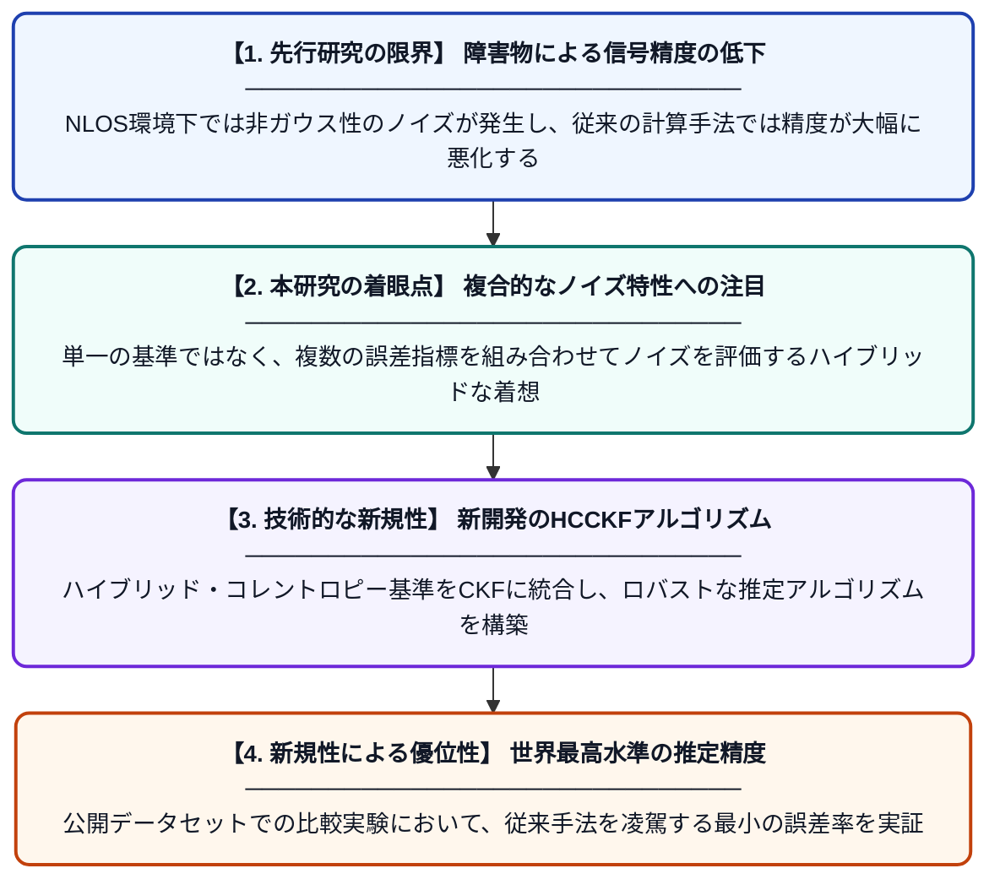

# NLOS環境下でのハイブリッド・コレントロピーに基づくロバストなUWB/SINS位置推定

**Original Title**: *Hybrid-Correntropy-Based Robust UWB/SINS Localization Under NLOS Conditions*

> **💡 一言要約**: 障害物に強い新アルゴリズムで、ドローン位置を正確に特定

| 項目 | 内容 |
|---|---|
| **著者** | B Jiang, R Wang, Z Xiong, J Zhao |
| **掲載誌** | IEEE Sensors Journal 2026 |
| **アラートキーワード** | kalman filter |
| **原文リンク** | [https://ieeexplore.ieee.org/abstract/document/11780712/](https://ieeexplore.ieee.org/abstract/document/11780712/) |
| **PDF版要約** | [README.pdf](./README.pdf) |

---

## 📊 新規性の図解（先行研究との違いと本研究のブレークスルー）

## 📝 要約

UWB（超広帯域無線）とSINS（慣性航法システム）を組み合わせた位置推定において、障害物による信号遮断（NLOS）に強い「ハイブリッド・コレントロピー・カルマンフィルタ（HCCKF）」を提案しました。ドローンの公開データセットを用いた検証では、従来の手法を上回る誤差数センチレベルの高精度な位置推定に成功しています。

## ❓ どんな問題に取り組んだか

UWBを利用した位置推定は、壁などの障害物によって信号が遅延するNLOS（非見通し）環境下で大きな誤差が生じます。従来のカルマンフィルタでは、このような特殊なノイズを適切に処理できず、ドローンなどの自律移動体の制御に支障をきたすことが課題でした。

## ✨ 何が新しい？何がすごい？（新規性）

本研究の核心は、複数の統計的指標を組み合わせた「ハイブリッド・コレントロピー基準」をキューバチュア・カルマンフィルタ（CKF）に導入した点にあります。従来の単一の基準（MCC）では対処しきれなかった複雑なノイズ成分を動的に重み付けして排除する仕組みを構築しました。公開されているUAVのTDOAデータセットを用いた実験では、全試行において従来手法を上回る0.051〜0.165mという最小の推定誤差（RMSE）を達成しました。

## 🎓 大学1年生向けの解説

GPSが届かない室内などでドローンの位置を知るには、無線（UWB）とセンサー（SINS）を使いますが、壁などの障害物があると無線が乱れて位置が分からなくなってしまいます。この研究では、その「乱れたデータ」を数学的な工夫で賢く取り除く新しい計算方法（フィルタ）を作りました。この方法を使うと、障害物が多い場所でもドローンの位置を数センチのズレだけで正確に把握できるようになります。これによって、複雑な建物の中でもドローンを安全に飛ばせるようになります。
