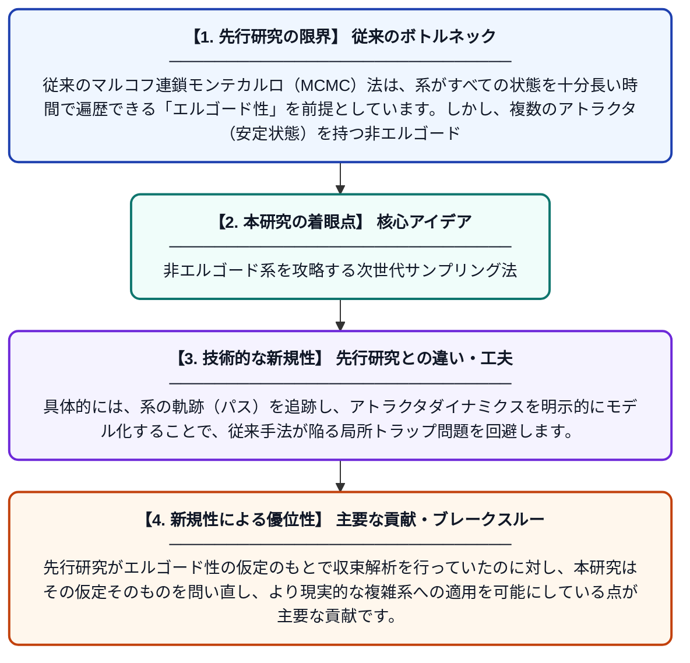

# ポストモンテカルロF：非エルゴード系におけるパス追跡とアトラクタダイナミクスサンプリング

**Original Title**: *Post-Monte Carlo F; Path Tracking and Attractor Dynamics Sampling in Non-Ergodic Systems*

> **💡 一言要約**: 非エルゴード系を攻略する次世代サンプリング法

| 項目 | 内容 |
|---|---|
| **著者** | Z Ziqing |
| **掲載誌** | 2026 |
| **アラートキーワード** | MCMC |
| **PDF** | [https://www.researchgate.net/profile/Changzheng-Zhou/publication/410722392_Post-Monte_Carlo_F_Path_Tracking_and_Attractor_Dynamics_Sampling_in_Non-Ergodic_Systems/links/6a61bffd303c7d450cb051fd/Post-Monte-Carlo-F-Path-Tracking-and-Attractor-Dynamics-Sampling-in-Non-Ergodic-Systems.pdf](https://www.researchgate.net/profile/Changzheng-Zhou/publication/410722392_Post-Monte_Carlo_F_Path_Tracking_and_Attractor_Dynamics_Sampling_in_Non-Ergodic_Systems/links/6a61bffd303c7d450cb051fd/Post-Monte-Carlo-F-Path-Tracking-and-Attractor-Dynamics-Sampling-in-Non-Ergodic-Systems.pdf) |
| **原文リンク** | [https://www.researchgate.net/profile/Changzheng-Zhou/publication/410722392_Post-Monte_Carlo_F_Path_Tracking_and_Attractor_Dynamics_Sampling_in_Non-Ergodic_Systems/links/6a61bffd303c7d450cb051fd/Post-Monte-Carlo-F-Path-Tracking-and-Attractor-Dynamics-Sampling-in-Non-Ergodic-Systems.pdf](https://www.researchgate.net/profile/Changzheng-Zhou/publication/410722392_Post-Monte_Carlo_F_Path_Tracking_and_Attractor_Dynamics_Sampling_in_Non-Ergodic_Systems/links/6a61bffd303c7d450cb051fd/Post-Monte-Carlo-F-Path-Tracking-and-Attractor-Dynamics-Sampling-in-Non-Ergodic-Systems.pdf) |
| **PDF版要約** | [README.pdf](./README.pdf) |

---

## 📊 新規性の図解（先行研究との違いと本研究のブレークスルー）

## 📝 要約

本論文は、マルコフ連鎖モンテカルロ（MCMC）法が「エルゴード性」を前提としているために、非エルゴード系（複数の安定状態が存在し、系が全空間を均一に探索できない系）では根本的に破綻するという問題を体系的に分析しています。従来のMCMCが定常分布への収束を目標とするフレームワークでは対処できないジレンマを明確化し、パス追跡とアトラクタダイナミクスに基づく新たなサンプリング手法を提案しています。

## ❓ どんな問題に取り組んだか

従来のマルコフ連鎖モンテカルロ（MCMC）法は、系がすべての状態を十分長い時間で遍歴できる「エルゴード性」を前提としています。しかし、複数のアトラクタ（安定状態）を持つ非エルゴード系では、サンプラーが局所的な領域に閉じ込められ、正しい統計的推定が行えないという根本的な問題があります。この問題は機械学習・物理シミュレーション・最適化など幅広い分野で深刻な障害となっています。

## ✨ 何が新しい？何がすごい？（新規性）

本研究は、MCMCの収束保証が崩壊する非エルゴード系を対象に、「定常分布への収束」という従来パラダイムを脱却した新しいフレームワーク「Post-Monte Carlo F」を提案しています。具体的には、系の軌跡（パス）を追跡し、アトラクタダイナミクスを明示的にモデル化することで、従来手法が陥る局所トラップ問題を回避します。先行研究がエルゴード性の仮定のもとで収束解析を行っていたのに対し、本研究はその仮定そのものを問い直し、より現実的な複雑系への適用を可能にしている点が主要な貢献です。

## 🎓 大学1年生向けの解説

モンテカルロ法とは、サイコロを何度も振るようにランダムなサンプリングを繰り返して、難しい計算（例：複雑な確率分布の平均）を近似的に解く手法です。ただし、この手法はサンプリングが「全域をまんべんなく探索できる」という条件（エルゴード性）が必要です。現実の複雑なシステム（例：たんぱく質の折りたたみや深層学習の損失関数）では、いくつかの「谷」（安定状態）に分かれていてその間を移動しにくく、従来の手法では一つの谷にはまり込んでしまいます。この論文では、そのような「谷が複数ある系」でも正しくサンプリングできる新しい方法を考案し、従来の限界を突破しています。
