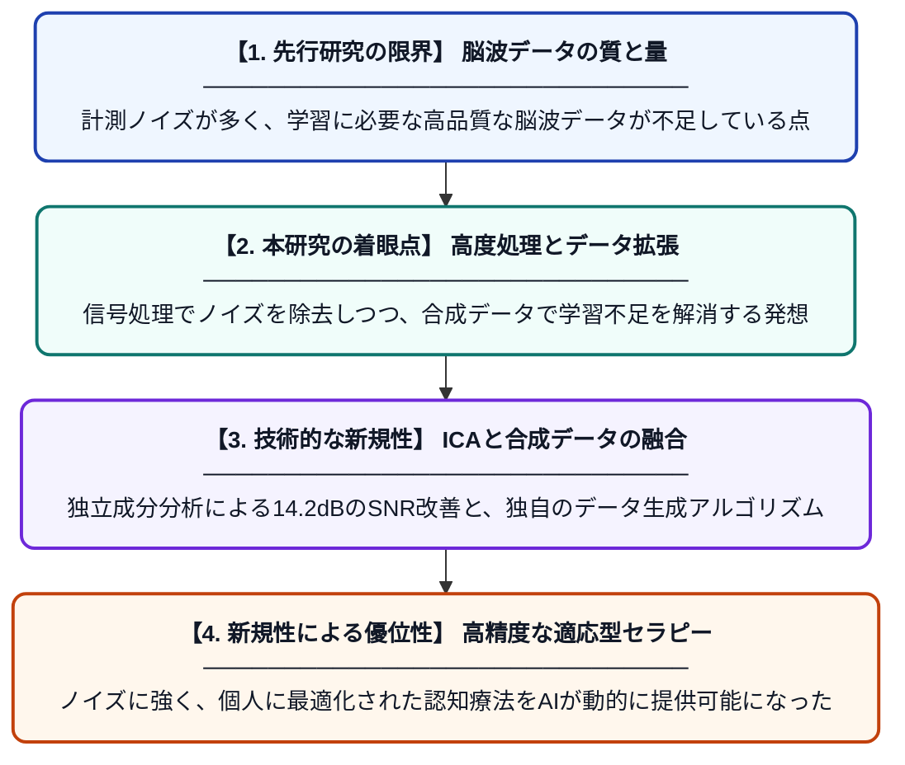

# 合成データ拡張を用いた脳波駆動型適応認知療法

**Original Title**: *EEG-Driven Adaptive Cognitive Therapy with Synthetic Data Augmentation*

> **💡 一言要約**: 脳波とAIで心に寄り添う次世代の認知療法

| 項目 | 内容 |
|---|---|
| **著者** | TS Sayed, APK Tiwari, HM Upadhyay, KM Zimal… |
| **掲載誌** | … International Conference on … 2026 |
| **アラートキーワード** | ICA |
| **原文リンク** | [https://ieeexplore.ieee.org/abstract/document/11766115/](https://ieeexplore.ieee.org/abstract/document/11766115/) |
| **PDF版要約** | [README.pdf](./README.pdf) |

---

## 📊 新規性の図解（先行研究との違いと本研究のブレークスルー）

## 📝 要約

脳波（EEG）データをリアルタイムで解析し、ユーザーの精神状態に合わせて内容を変化させるAIセラピーコンパニオン「NeuroBuddy」を提案しています。独立成分分析（ICA）を用いた高度なノイズ除去と、不足するデータを補うための合成データ拡張を組み合わせることで、精度の高い適応型セラピーを実現しました。

## ❓ どんな問題に取り組んだか

従来の認知療法は個人の心理状態を客観的かつリアルタイムに反映することが難しく、主観に頼らざるを得ない面がありました。また、脳波を用いた解析では、瞬きや筋電などのノイズが大きく、精度の高いデータを十分に確保することが困難であるという課題がありました。

## ✨ 何が新しい？何がすごい？（新規性）

本研究は「NeuroBuddy」というフルスタックAIを構築し、ICA（独立成分分析）とFFT（高速フーリエ変換）を組み合わせることで、信号対雑音比（SNR）を14.2dB向上させることに成功しました。さらに、医療分野で不足しがちな脳波データを「合成データ拡張」によって補完する手法を導入しています。これにより、限られた実データでも高精度な学習を可能にし、ユーザーに最適化された治療を動的に提供できる点が画期的です。

## 🎓 大学1年生向けの解説

この研究は、人間の「脳波」を読み取って、その時の気分にぴったりのカウンセリングをしてくれるAIを作ったというお話です。脳波にはたくさんの雑音が混じってしまうのが難点ですが、数学的な工夫でその雑音をきれいに取り除くことに成功しました。また、AIの学習に使うデータが足りないときには、AI自身に本物そっくりのデータを作らせて練習させる仕組みも備えています。これにより、スマホやPCを通していつでも自分専用のセラピストと対話できるような未来を目指しています。
