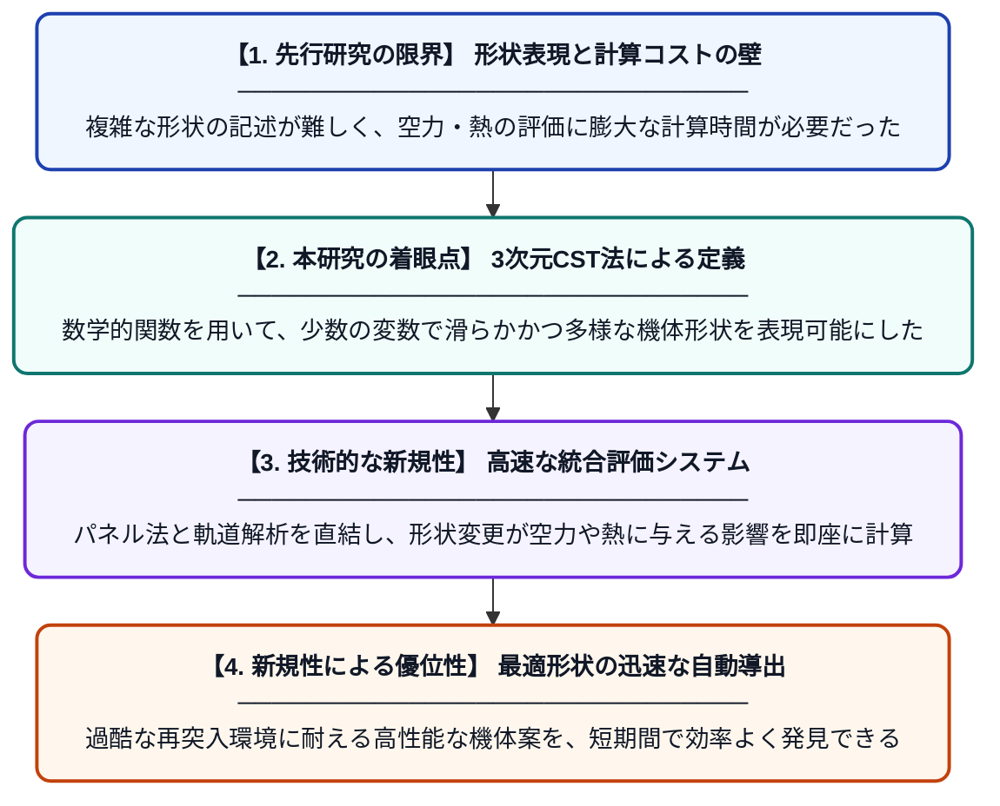

# 宇宙機の空力熱力学的最適化に向けた概念的フレームワーク

**Original Title**: *Conceptual Framework for Aerothermodynamic Optimization of Space Vehicles*

> **💡 一言要約**: 極超音速再突入機の最適形状を高速に導き出す設計基盤

| 項目 | 内容 |
|---|---|
| **著者** | I Figueiras, G Musso, A de Souza, F Afonso, F Lau |
| **掲載誌** | Journal of Spacecraft and … 2026 |
| **アラートキーワード** | optimization |
| **PDF** | [https://arc.aiaa.org/doi/pdf/10.2514/1.A36801](https://arc.aiaa.org/doi/pdf/10.2514/1.A36801) |
| **原文リンク** | [https://arc.aiaa.org/doi/pdf/10.2514/1.A36801](https://arc.aiaa.org/doi/pdf/10.2514/1.A36801) |
| **PDF版要約** | [README.pdf](./README.pdf) |

---

## 📊 新規性の図解（先行研究との違いと本研究のブレークスルー）

## 📝 要約

極超音速で大気圏へ再突入する宇宙機の設計を効率化するため、3次元の形状定義と空気力学、軌道解析を統合した新しい最適化フレームワークを提案しています。3次元CST法を用いることで、少数のパラメータで多様な機体形状を柔軟に表現し、初期設計段階での迅速な評価を可能にしました。

## ❓ どんな問題に取り組んだか

宇宙機の開発初期段階において、極超音速飛行時の複雑な空気力学特性と熱負荷を考慮しながら、最適な機体形状を探索することは計算コストの面で非常に困難でした。また、従来の形状表現法では設計の自由度が低く、革新的な形状を効率よく評価できないという課題がありました。

## ✨ 何が新しい？何がすごい？（新規性）

3次元CST（Class-Shape Transformation）法を採用し、滑らかな幾何形状を少数のパラメータで高精度に記述できるようにした点が最大の特徴です。これにパネル法ベースの空力計算と3自由度の軌道解析を組み合わせることで、設計初期に空力熱力学的な制約を満たしつつ性能を最大化する形状を高速に探索できます。先行研究よりも形状の自由度と計算効率を高い次元で両立させた点が画期的です。

## 🎓 大学1年生向けの解説

宇宙船が宇宙から地球に戻る時は、空気との凄まじい摩擦で非常に高い熱が発生します。この研究は、その熱に耐えつつ安全に飛べる「最高の形」をコンピュータで自動的に見つけるための新しい仕組みを作りました。複雑な形を少ない数字で表現する数学的な工夫を取り入れることで、計算を大幅にスピードアップさせています。これにより、未来の宇宙船の設計がより早く、正確に行えるようになります。
