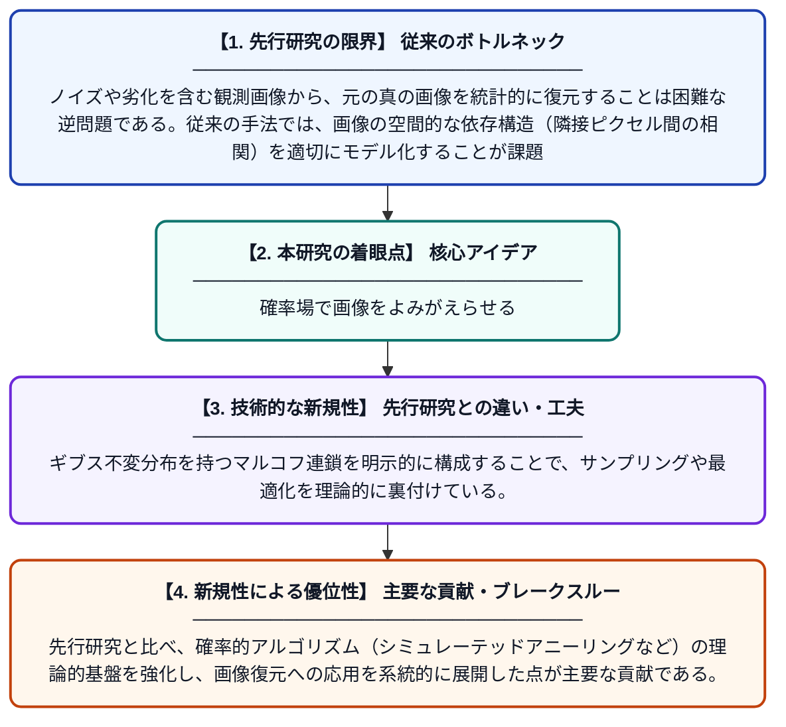

# 有限格子上の離散マルコフ確率場とギブス分布を用いた画像復元

**Original Title**: *Saul B. Gelfand School of Electrical Engineering Purdue University West Lafayette, IN 47907 and*

> **💡 一言要約**: 確率場で画像をよみがえらせる

| 項目 | 内容 |
|---|---|
| **著者** | SK Mitter |
| **アラートキーワード** | MRFs Markov |
| **原文リンク** | [https://dspace.mit.edu/server/api/core/bitstreams/871b4a78-e954-4e0f-94b4-e71ad93fc565/content](https://dspace.mit.edu/server/api/core/bitstreams/871b4a78-e954-4e0f-94b4-e71ad93fc565/content) |
| **PDF版要約** | [README.pdf](./README.pdf) |

---

## 📊 新規性の図解（先行研究との違いと本研究のブレークスルー）

## 📝 要約

本論文は、有限格子上で定義される離散マルコフ確率場（MRF）を用いた画像処理・復元手法を論じている。ギブス不変分布を持つマルコフ連鎖の構成を中心に、観測画像に対する統計的モデルを構築する枠組みを提案している。確率論的アプローチを通じて、ノイズを含む画像から元の画像を推定する方法論を体系化している。

## ❓ どんな問題に取り組んだか

ノイズや劣化を含む観測画像から、元の真の画像を統計的に復元することは困難な逆問題である。従来の手法では、画像の空間的な依存構造（隣接ピクセル間の相関）を適切にモデル化することが課題であった。これに対して、確率場の理論を用いた厳密な数理的枠組みが求められていた。

## ✨ 何が新しい？何がすごい？（新規性）

本研究は、離散マルコフ確率場とギブス分布を組み合わせることで、画像の局所的な空間依存性を統計物理学の枠組みで厳密に記述した点が新しい。ギブス不変分布を持つマルコフ連鎖を明示的に構成することで、サンプリングや最適化を理論的に裏付けている。先行研究と比べ、確率的アルゴリズム（シミュレーテッドアニーリングなど）の理論的基盤を強化し、画像復元への応用を系統的に展開した点が主要な貢献である。

## 🎓 大学1年生向けの解説

デジタル画像は多くの場合ノイズ（乱れ）が混じっており、元のきれいな画像を取り戻したいという問題があります。この論文では、画像の各ピクセルが隣のピクセルと関係を持つという性質を「マルコフ確率場」という数学的な道具で表現します。さらに、物理学のエネルギー概念を借りた「ギブス分布」を使うことで、どの画像が最もありそうかを確率的に計算できるようにします。これにより、ランダムなシミュレーションを繰り返すことで、ノイズの少ない元の画像を統計的に推定することが可能になります。
