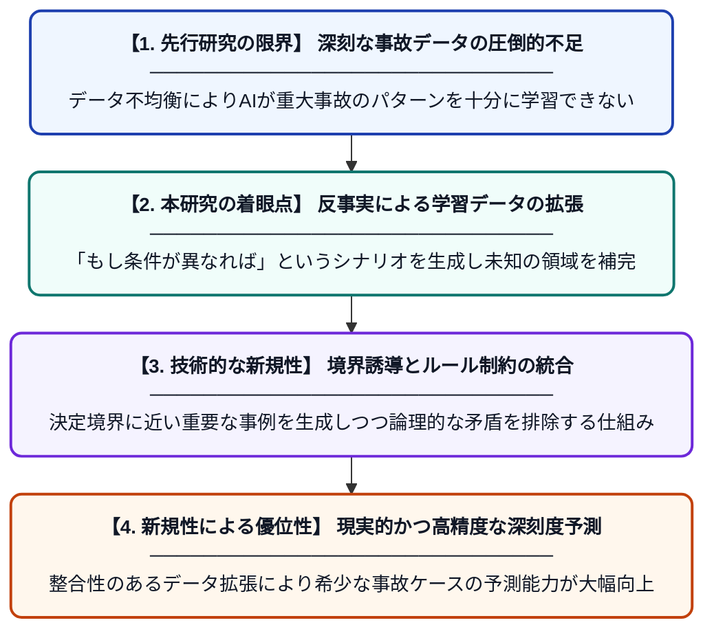

# BRACE：境界誘導およびルール制約を用いた反事実的データ拡張による事故深刻度予測

**Original Title**: *BRACE: Boundary-guided, rule-constrained counterfactual augmentation for crash-severity prediction*

> **💡 一言要約**: 反事実データで事故予測の精度と信頼性を革新

| 項目 | 内容 |
|---|---|
| **著者** | J Hu, D Gao |
| **掲載誌** | Reliability Engineering & System Safety 2026 |
| **アラートキーワード** | sparse coding |
| **原文リンク** | [https://www.sciencedirect.com/science/article/pii/S0951832026015954](https://www.sciencedirect.com/science/article/pii/S0951832026015954) |
| **PDF版要約** | [README.pdf](./README.pdf) |

---

## 📊 新規性の図解（先行研究との違いと本研究のブレークスルー）

## 📝 要約

交通事故の深刻度を予測する際、重大事故のデータ不足とデータの偏りが課題となります。本研究は、境界誘導と論理的なルール制約を組み合わせた「BRACE」という手法を提案し、現実的で整合性の取れた反事実的な学習データを生成することで予測精度を向上させました。

## ❓ どんな問題に取り組んだか

交通事故データは深刻な事故の件数が極めて少なく、予測因子の組み合わせにも大きな偏りがあるため、AIが稀なケースを正確に学習できません。また、従来のデータ水増し手法では、現実の交通規則や物理法則に反する不自然なデータが生成されてしまうという課題がありました。

## ✨ 何が新しい？何がすごい？（新規性）

本研究は、決定境界に基づいて重要なサンプルを生成する「境界誘導」と、生成されたデータが現実的であることを保証する「ルール制約」を統合した手法BRACEを開発しました。従来の単純なデータ拡張とは異なり、反事実的な（もし～だったらという）シナリオを論理的整合性を保ちながら生成できる点が画期的です。これにより、疎なデータ領域を効果的に補完し、郡レベルのミクロな予測において高いパフォーマンスを達成しました。

## 🎓 大学1年生向けの解説

交通事故がどれくらい深刻になるかをAIで予測しようとしても、重大な事故は数が少ないため、AIが得意なパターンばかりを覚えてしまう問題がありました。そこでこの研究では、「もし天候が違っていたら事故はどうなっていたか」という架空のシナリオをAIに作らせて学習データを増やしました。ただ適当に作るのではなく、現実のルールに矛盾しないデータだけを作るように工夫したのがポイントです。その結果、珍しいタイプの事故でも正確に予測できるようになりました。
