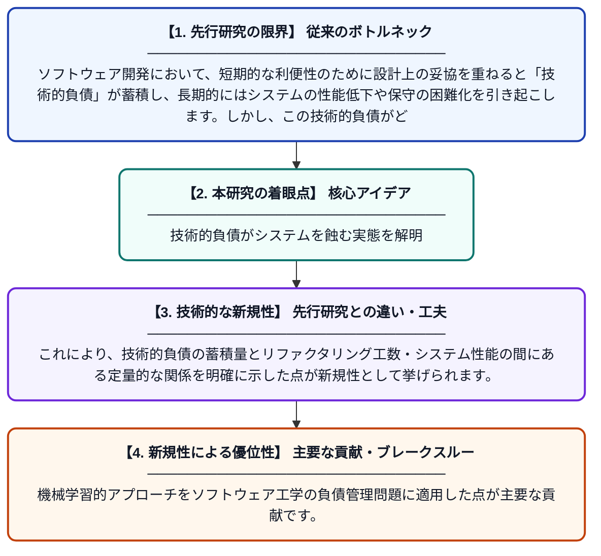

# ソフトウェアシステムにおける技術的負債の分析：システム性能と保守性への影響

**Original Title**: *Technical Debt Analysis In Software Systems: Implications For System Performance And Maintainability*

> **💡 一言要約**: 技術的負債がシステムを蝕む実態を解明

| 項目 | 内容 |
|---|---|
| **著者** | B Vala, J Shekhawat, SS Kolaventi, G Bhatnagar |
| **掲載誌** | International Journal of AI and Machine Learning 2026 |
| **アラートキーワード** | independent component ... |
| **PDF** | [https://www.svedbergopen.com/index.php/ijaiml/article/download/654/505](https://www.svedbergopen.com/index.php/ijaiml/article/download/654/505) |
| **原文リンク** | [https://www.svedbergopen.com/index.php/ijaiml/article/download/654/505](https://www.svedbergopen.com/index.php/ijaiml/article/download/654/505) |
| **PDF版要約** | [README.pdf](./README.pdf) |

---

## 📊 新規性の図解（先行研究との違いと本研究のブレークスルー）

## 📝 要約

本研究は、ソフトウェア開発における「技術的負債」がシステムの性能や保守性に与える影響を定量的に分析したものです。独立成分分析（ICA）を用いて特徴抽出を行い、技術的負債の蓄積がリファクタリング工数の増大やシステム品質の低下を招くことを示しました。これにより、技術的負債の早期管理の重要性が裏付けられています。

## ❓ どんな問題に取り組んだか

ソフトウェア開発において、短期的な利便性のために設計上の妥協を重ねると「技術的負債」が蓄積し、長期的にはシステムの性能低下や保守の困難化を引き起こします。しかし、この技術的負債がどの程度具体的にシステムの品質指標に影響するかを定量的に示した研究は限られていました。本研究はその影響を機械学習的手法を用いて明確化しようとしています。

## ✨ 何が新しい？何がすごい？（新規性）

従来の技術的負債研究が定性的な評価や単純な統計分析に留まっていたのに対し、本研究は独立成分分析（ICA）を活用して統計的に独立した特徴量を抽出し、より精度の高いモデル学習を実現しました。これにより、技術的負債の蓄積量とリファクタリング工数・システム性能の間にある定量的な関係を明確に示した点が新規性として挙げられます。機械学習的アプローチをソフトウェア工学の負債管理問題に適用した点が主要な貢献です。

## 🎓 大学1年生向けの解説

プログラムを作るとき、急いで「とりあえず動けばいい」という雑なコードを書き続けると、後から直すのがどんどん大変になります。これを「技術的負債」と呼びます。この研究では、その負債がどれだけ溜まると、どのくらいシステムが遅くなったり、修正が難しくなるかを数学的な方法で調べました。結果として、負債を早めに返済（コードを整理）することが、長期的にはコストを大幅に減らせることが分かりました。
