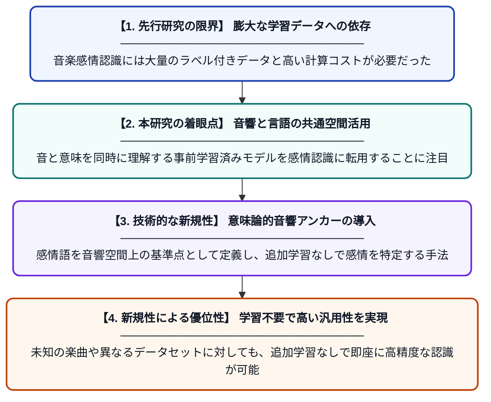

# MUSE：意味論的音響アンカーを用いた学習不要な音楽感情認識

**Original Title**: *MUSE: Training-Free Music Emotion Recognition with Semantic Acoustic Anchors*

> **💡 一言要約**: 追加学習ゼロで音楽の感情を解き明かす新技術

| 項目 | 内容 |
|---|---|
| **著者** | Z Huang, H Xia, Y Tan, S Song |
| **掲載誌** | Proceedings of the 34th ACM International … 2026 |
| **アラートキーワード** | affective computing |
| **原文リンク** | [https://dl.acm.org/doi/abs/10.1145/3767308.3836511](https://dl.acm.org/doi/abs/10.1145/3767308.3836511) |
| **PDF版要約** | [README.pdf](./README.pdf) |

---

## 📊 新規性の図解（先行研究との違いと本研究のブレークスルー）

## 📝 要約

大規模な音響・言語事前学習モデルを活用し、追加の訓練（ファインチューニング）を一切行わずに音楽の感情を判定する新手法「MUSE」を提案しています。意味的な音響アンカーという概念を導入することで、抽象的な感情表現と複雑な音楽特徴を効率的に結びつけることに成功しました。

## ❓ どんな問題に取り組んだか

従来の音楽感情認識手法は、膨大なラベル付きデータを用いた重い学習プロセスが必要であり、未知の感情表現や異なるジャンルへの適応が困難でした。また、音響特徴と感情という主観的なラベルの間の「意味的な溝」を埋めることも大きな課題となっていました。

## ✨ 何が新しい？何がすごい？（新規性）

本論文の核心は、追加学習なしで高い認識性能を実現する「トレーニングフリー」なアプローチです。既存の対照学習モデル（CLAP等）をベースにしつつ、特定の感情に対応する「意味論的音響アンカー」を定義することで、音響空間内での相対的な位置関係から感情を特定する仕組みを構築しました。これにより、計算コストを抑えながら、従来手法に匹敵または凌駕するゼロショット認識性能を達成しています。

## 🎓 大学1年生向けの解説

音楽を聴いて「楽しい」「悲しい」と感じる心を、AIに自動で理解させる研究です。これまでのAIは数千曲の「正解データ」を詰め込まないと感情がわかりませんでしたが、この研究では「言葉と音の関係」をあらかじめ知っている別のAIを賢く利用することで、事前の詰め込み作業を省きました。音楽の雰囲気を「言葉の物差し」で測るような新しい仕組みを使って、より人間に近い感覚で音楽を分類できるようにしたのがすごいところです。
