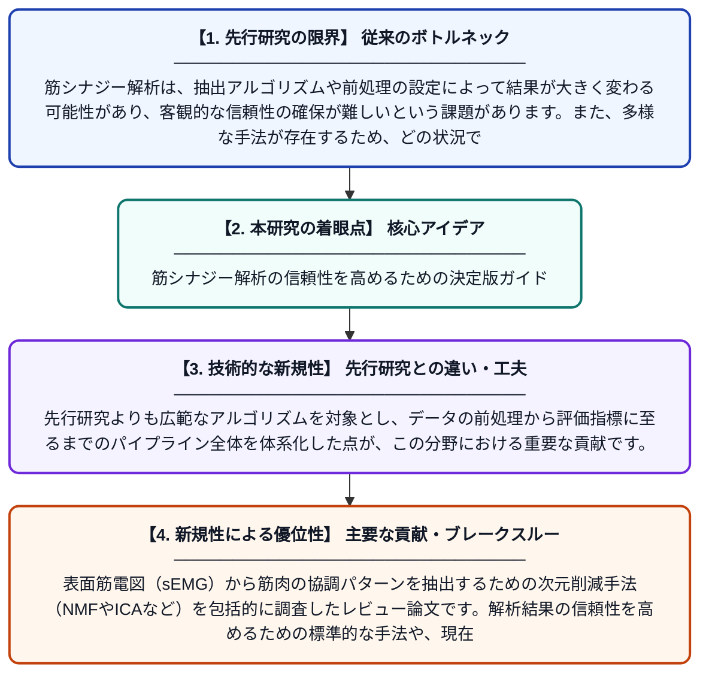

# 堅牢で信頼性の高い筋シナジー解析に向けて：シナジー抽出手法に関する体系的なサーベイ

**Original Title**: *Toward Robust and Reliable Muscle Synergy Analysis: A Methodological Survey of Synergy Extraction*

> **💡 一言要約**: 筋シナジー解析の信頼性を高めるための決定版ガイド

| 項目 | 内容 |
|---|---|
| **著者** | Y Chen, X Wang, Y Wang, P Xie, L Zhan, H Liu, H Yin… |
| **掲載誌** | Sensors 2026 |
| **アラートキーワード** | independent component ... |
| **原文リンク** | [https://www.mdpi.com/1424-8220/26/21/6700](https://www.mdpi.com/1424-8220/26/21/6700) |
| **PDF版要約** | [README.pdf](./README.pdf) |

---

## 📊 新規性の図解（先行研究との違いと本研究のブレークスルー）

## 📝 要約

表面筋電図（sEMG）から筋肉の協調パターンを抽出するための次元削減手法（NMFやICAなど）を包括的に調査したレビュー論文です。解析結果の信頼性を高めるための標準的な手法や、現在の技術的課題、将来の展望について整理しています。

## ❓ どんな問題に取り組んだか

筋シナジー解析は、抽出アルゴリズムや前処理の設定によって結果が大きく変わる可能性があり、客観的な信頼性の確保が難しいという課題があります。また、多様な手法が存在するため、どの状況でどの手法を用いるべきかの明確な基準が不足していました。

## ✨ 何が新しい？何がすごい？（新規性）

本研究は、非負値行列因子分解（NMF）や独立成分分析（ICA）といった主要な手法を網羅的に比較し、ロバスト性（頑健性）の観点から評価を行っています。先行研究よりも広範なアルゴリズムを対象とし、データの前処理から評価指標に至るまでのパイプライン全体を体系化した点が、この分野における重要な貢献です。

## 🎓 大学1年生向けの解説

人間が複雑な動きをするとき、脳は個々の筋肉をバラバラに動かすのではなく、いくつかの筋肉を「グループ（筋シナジー）」としてまとめて制御しています。この研究は、筋肉の活動記録からそのグループをどうやって正確に見つけ出すか、という計算方法をまとめたものです。どんな計算を使えば間違いが少なく、信頼できる結果が出るのかを詳しく解説しています。
