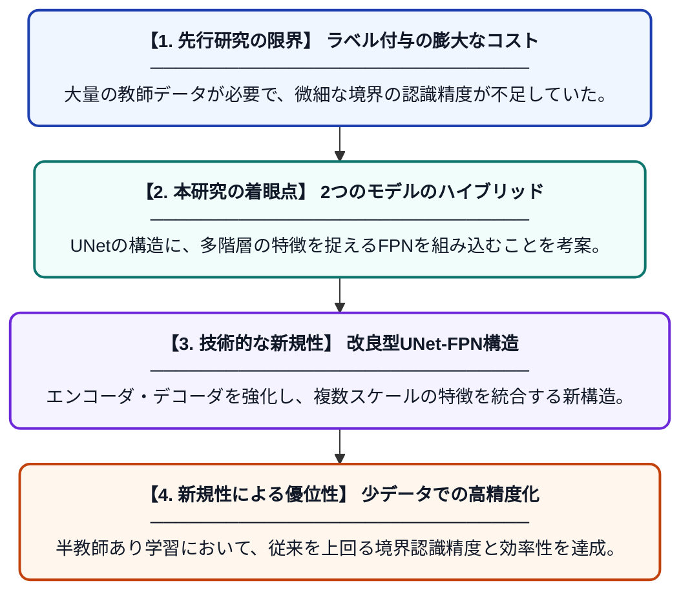

# 改良型UNetとFPNに基づく半教師あり画像セマンティックセグメンテーション手法

**Original Title**: *Semi-supervised Image Semantic Segmentation Scheme Based on Improved UNet and FPN.*

> **💡 一言要約**: UNetとFPNの融合で、少ないデータでも高精度な画像認識

| 項目 | 内容 |
|---|---|
| **著者** | J Zhang, Y Zhang |
| **掲載誌** | Journal of Information Processing Systems 2026 |
| **アラートキーワード** | Semi supervise |
| **原文リンク** | [https://openurl.ebsco.com/contentitem/gcd:198731433?sid=ebsco:plink:crawler-gcd&id=ebsco:gcd:198731433&crl=c&jrnl=1976913X](https://openurl.ebsco.com/contentitem/gcd:198731433?sid=ebsco:plink:crawler-gcd&id=ebsco:gcd:198731433&crl=c&jrnl=1976913X) |
| **PDF版要約** | [README.pdf](./README.pdf) |

---

## 📊 新規性の図解（先行研究との違いと本研究のブレークスルー）

## 📝 要約

改良されたUNetと特徴ピラミッドネットワーク（FPN）を統合し、精度の高い画像セマンティックセグメンテーションを実現する新しい半教師あり学習手法を提案しています。エンコーダ・デコーダ構造を核としながら、マルチスケールの特徴を効果的に抽出することで、ラベル付きデータが少ない環境でも高い性能を発揮します。

## ❓ どんな問題に取り組んだか

画像セマンティックセグメンテーションにおいて、すべての画素に正解ラベルを付与する作業は膨大なコストがかかるという課題があります。また、従来のUNet単体では、複雑な形状や異なる大きさの物体を正確に捉えきれない限界がありました。

## ✨ 何が新しい？何がすごい？（新規性）

本研究は、医療画像などで定評のあるUNetに、物体検出に強いFPN（Feature Pyramid Network）の考え方を統合した点が画期的です。これにより、画像の解像度を維持しつつ、広範囲な文脈情報と細部の情報を同時に学習できる「改良型UNet-FPN構造」を構築しました。先行研究の半教師あり学習と比較して、特に境界線の抽出精度と少数の学習データに対する頑健性が大幅に向上しています。

## 🎓 大学1年生向けの解説

画像の中に何が写っているかをピクセル単位で塗り分けるAI技術についての研究です。通常、AIを賢くするには大量の「正解画像」が必要ですが、この論文では少ない正解でも賢くなれる工夫をしています。具体的には、AIの内部構造を2つの優れたモデルの良いとこ取りをすることで、小さなものから大きなものまで正確に見分けることができるようになりました。これにより、AIを育てるための手間を大きく減らすことが期待できます。
