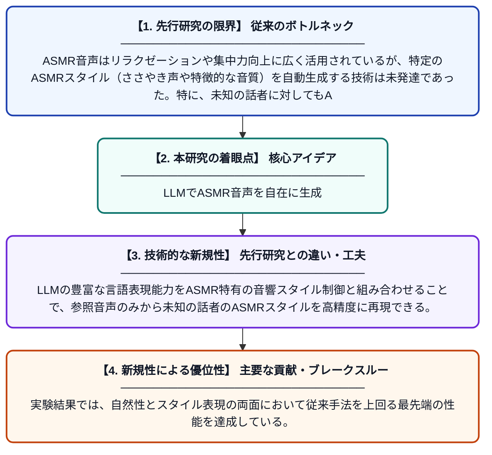

# DeepASMR：大規模言語モデルを用いたゼロショットASMR音声生成

**Original Title**: *DeepASMR: LLM-Based Zero-Shot ASMR Speech Generation*

> **💡 一言要約**: LLMでASMR音声を自在に生成

| 項目 | 内容 |
|---|---|
| **著者** | L Zhang, T Zhou, H Sun, M Bi, Y Qian |
| **掲載誌** | IEEE Transactions on Audio, Speech and Language Processing 2026 |
| **アラートキーワード** | zero shot |
| **原文リンク** | [https://ieeexplore.ieee.org/abstract/document/11623470/](https://ieeexplore.ieee.org/abstract/document/11623470/) |
| **PDF版要約** | [README.pdf](./README.pdf) |

---

## 📊 新規性の図解（先行研究との違いと本研究のブレークスルー）

## 📝 要約

本論文では、ASMRスタイルの音声をゼロショット（未知の話者でも参照音声のみで適応可能）で生成する初のフレームワーク「DeepASMR」を提案している。大規模言語モデル（LLM）を活用することで、高い自然性とASMRスタイルの再現を同時に実現する。広範な実験により、提案手法が最先端の自然性とスタイル表現において優れた性能を示すことが確認された。

## ❓ どんな問題に取り組んだか

ASMR音声はリラクゼーションや集中力向上に広く活用されているが、特定のASMRスタイル（ささやき声や特徴的な音質）を自動生成する技術は未発達であった。特に、未知の話者に対してもASMRスタイルを適応させる「ゼロショット話者適応」は大きな技術的課題として残されていた。

## ✨ 何が新しい？何がすごい？（新規性）

DeepASMRはASMR音声生成に特化した世界初のゼロショット対応フレームワークであり、既存の音声合成研究ではほとんど扱われていないASMRというニッチながら需要の高い領域を開拓した。LLMの豊富な言語表現能力をASMR特有の音響スタイル制御と組み合わせることで、参照音声のみから未知の話者のASMRスタイルを高精度に再現できる。実験結果では、自然性とスタイル表現の両面において従来手法を上回る最先端の性能を達成している。

## 🎓 大学1年生向けの解説

ASMRとは、ささやき声や自然音など、聴くとリラックスできる特殊な音声コンテンツのことです。この研究では、そのようなASMR音声をAIが自動で作り出す仕組みを初めて開発しました。特に「ゼロショット」という技術を使い、AIが一度も学習したことのない人の声でも、少しサンプル音声を聞かせるだけでASMRスタイルに変換できます。ChatGPTのような大規模言語モデルの技術を音声生成に応用することで、自然で高品質なASMR音声を生み出すことに成功しました。
