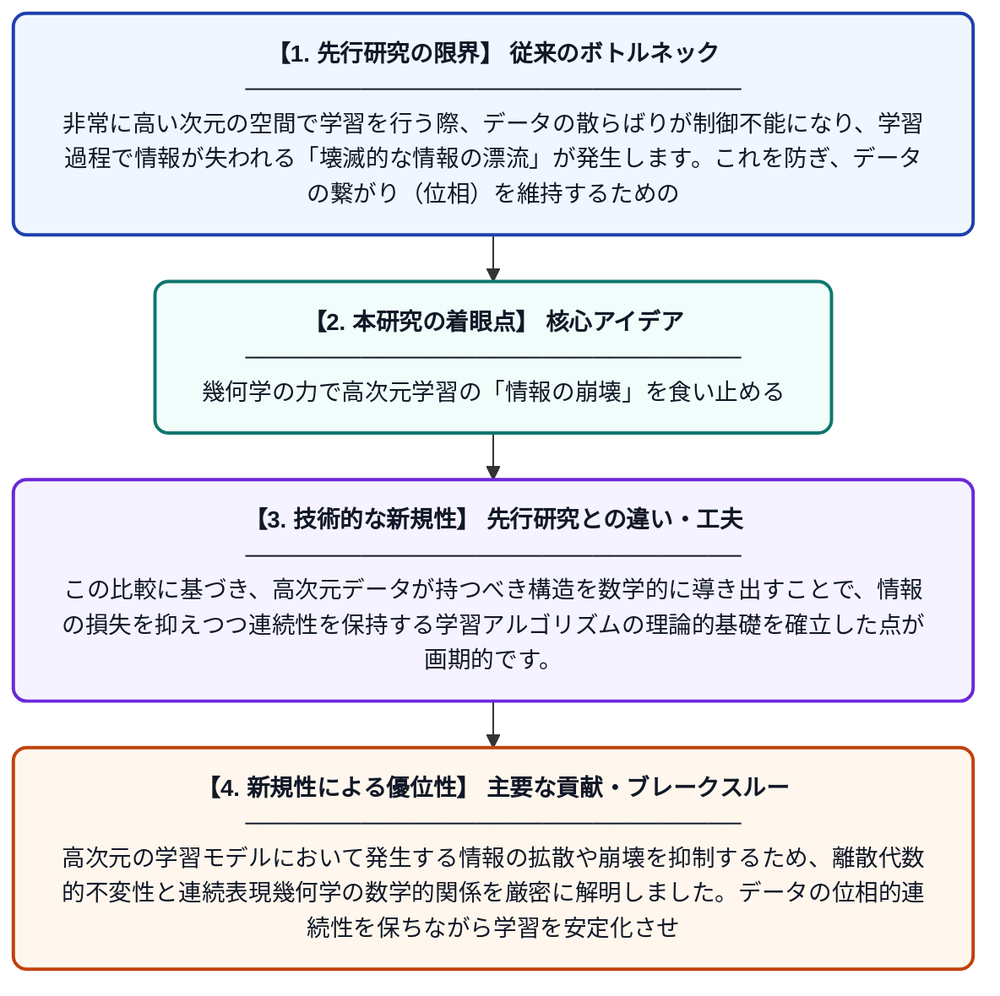

# 幾何学的リアリズムと経験的多様体：離散代数的不変性と連続表現幾何学の厳密な数学的比較

**Original Title**: *Geometric Realism and Empirical Manifolds: A Rigorous Mathematical Comparison of Discrete Algebraic Invariance and Continuous Representation Geometry in …*

> **💡 一言要約**: 幾何学の力で高次元学習の「情報の崩壊」を食い止める

| 項目 | 内容 |
|---|---|
| **著者** | MI Aksman |
| **アラートキーワード** | manifold learning |
| **PDF** | [https://www.researchgate.net/profile/Michael-Aksman/publication/416422434_Geometric_Realism_and_Empirical_Manifolds_A_Rigorous_Mathematical_Comparison_of_Discrete_Algebraic_Invariance_and_Continuous_Representation_Geometry_in_Artificial_Intelligence/links/6ad8118b7b0f3459e35b2b13/Geometric-Realism-and-Empirical-Manifolds-A-Rigorous-Mathematical-Comparison-of-Discrete-Algebraic-Invariance-and-Continuous-Representation-Geometry-in-Artificial-Intelligence.pdf](https://www.researchgate.net/profile/Michael-Aksman/publication/416422434_Geometric_Realism_and_Empirical_Manifolds_A_Rigorous_Mathematical_Comparison_of_Discrete_Algebraic_Invariance_and_Continuous_Representation_Geometry_in_Artificial_Intelligence/links/6ad8118b7b0f3459e35b2b13/Geometric-Realism-and-Empirical-Manifolds-A-Rigorous-Mathematical-Comparison-of-Discrete-Algebraic-Invariance-and-Continuous-Representation-Geometry-in-Artificial-Intelligence.pdf) |
| **原文リンク** | [https://www.researchgate.net/profile/Michael-Aksman/publication/416422434_Geometric_Realism_and_Empirical_Manifolds_A_Rigorous_Mathematical_Comparison_of_Discrete_Algebraic_Invariance_and_Continuous_Representation_Geometry_in_Artificial_Intelligence/links/6ad8118b7b0f3459e35b2b13/Geometric-Realism-and-Empirical-Manifolds-A-Rigorous-Mathematical-Comparison-of-Discrete-Algebraic-Invariance-and-Continuous-Representation-Geometry-in-Artificial-Intelligence.pdf](https://www.researchgate.net/profile/Michael-Aksman/publication/416422434_Geometric_Realism_and_Empirical_Manifolds_A_Rigorous_Mathematical_Comparison_of_Discrete_Algebraic_Invariance_and_Continuous_Representation_Geometry_in_Artificial_Intelligence/links/6ad8118b7b0f3459e35b2b13/Geometric-Realism-and-Empirical-Manifolds-A-Rigorous-Mathematical-Comparison-of-Discrete-Algebraic-Invariance-and-Continuous-Representation-Geometry-in-Artificial-Intelligence.pdf) |
| **PDF版要約** | [README.pdf](./README.pdf) |

---

## 📊 新規性の図解（先行研究との違いと本研究のブレークスルー）

## 📝 要約

高次元の学習モデルにおいて発生する情報の拡散や崩壊を抑制するため、離散代数的不変性と連続表現幾何学の数学的関係を厳密に解明しました。データの位相的連続性を保ちながら学習を安定化させるための、幾何学的構造の役割を数学的に定義しています。

## ❓ どんな問題に取り組んだか

非常に高い次元の空間で学習を行う際、データの散らばりが制御不能になり、学習過程で情報が失われる「壊滅的な情報の漂流」が発生します。これを防ぎ、データの繋がり（位相）を維持するための厳密な幾何学的ルールが必要とされていました。

## ✨ 何が新しい？何がすごい？（新規性）

離散的な数式的特徴（代数的不変性）と、滑らかな空間の性質（連続表現幾何学）という二つの異なる数学的アプローチを初めて厳密に比較しました。この比較に基づき、高次元データが持つべき構造を数学的に導き出すことで、情報の損失を抑えつつ連続性を保持する学習アルゴリズムの理論的基礎を確立した点が画期的です。

## 🎓 大学1年生向けの解説

AIが扱うデータが非常に複雑になると、情報がバラバラになってしまい、学習がうまくいかなくなることがあります。この論文は、データが本来持っている「形（幾何学）」に注目し、その形を壊さずに整理するための厳密な数学のルールを作りました。広大な砂漠で方位磁石や星座を頼りに正しい道を進むように、複雑なデータの中でも迷子にならずに学習を進めるための新しい「地図の書き方」を提案した研究です。
