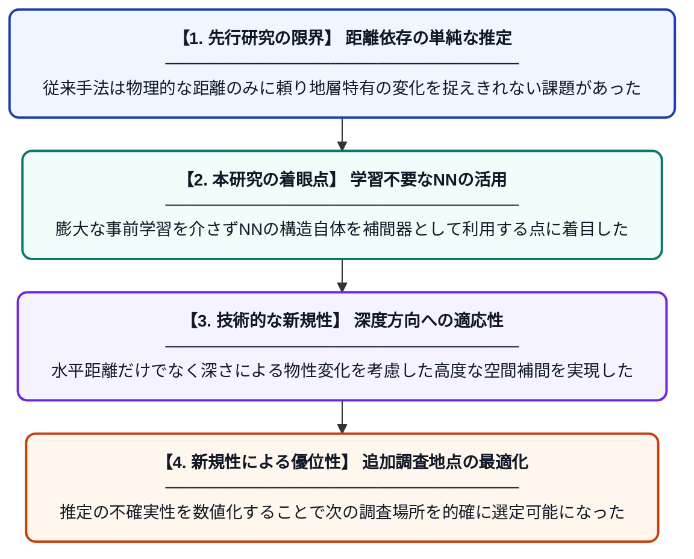

# 事前学習を必要としないニューラルネットワークによる2次元含水比分布補間と不確実性評価

**Original Title**: *事前学習を必要としないニューラルネットワークによる 2 次元含水比分布補間と不確実性評価*

> **💡 一言要約**: 事前学習不要で地盤の水分分布と「調査不足」を可視化

| 項目 | 内容 |
|---|---|
| **著者** | 坂本燿陽， 荻野俊寛， 今井勝利， 阿部剛成 |
| **掲載誌** | AI・データサイエンス論文集 2026 |
| **アラートキーワード** | ガウス過程 |
| **原文リンク** | [https://www.jstage.jst.go.jp/article/jsceiii/7/3/7_96/_article/-char/ja/](https://www.jstage.jst.go.jp/article/jsceiii/7/3/7_96/_article/-char/ja/) |
| **PDF版要約** | [README.pdf](./README.pdf) |

---

## 📊 新規性の図解（先行研究との違いと本研究のブレークスルー）

## 📝 要約

大量の教師データを必要としないニューラルネットワークを用い、地盤の2次元的な含水比分布を推定する新しい手法を提案しています。この手法は、従来のガウス過程回帰では難しかった深度方向の物性変化を反映した補間が可能であり、推定のばらつきから追加調査が必要な場所を特定できます。

## ❓ どんな問題に取り組んだか

地盤調査では得られるデータが限られており、従来のガウス過程回帰などの手法では単純な幾何学的距離に依存した推定になりがちでした。また、一般的なAI手法は膨大な学習データを必要とするため、特定の現場ごとに高精度な推定と不確実性の評価を両立させることが困難でした。

## ✨ 何が新しい？何がすごい？（新規性）

本研究の最大の特長は、事前学習を一切行わずにニューラルネットワークの構造そのものを事前情報として活用する点にあります。従来のガウス過程回帰が水平距離を重視するのに対し、本手法は深度方向のデータ密度や物性の急激な変化に対応した補間を実現しました。複数回の試行から算出される標準偏差を「不確実性」として定義し、追加調査の候補地を論理的に抽出できる仕組みを構築したことが大きな貢献です。

## 🎓 大学1年生向けの解説

地面の下にどれくらい水分が含まれているかを知ることは重要ですが、地面をあちこち掘り返すのは大変です。この研究では、少ない調査結果からAIを使って「調査していない場所」の状態を予想する方法を開発しました。このAIは事前に大量のデータを勉強させる必要がなく、その場所のデータだけで賢く予想してくれます。さらに「この場所は予想に自信がない」という地点も教えてくれるため、次にどこを掘って調べれば効率的かがひと目で分かります。
