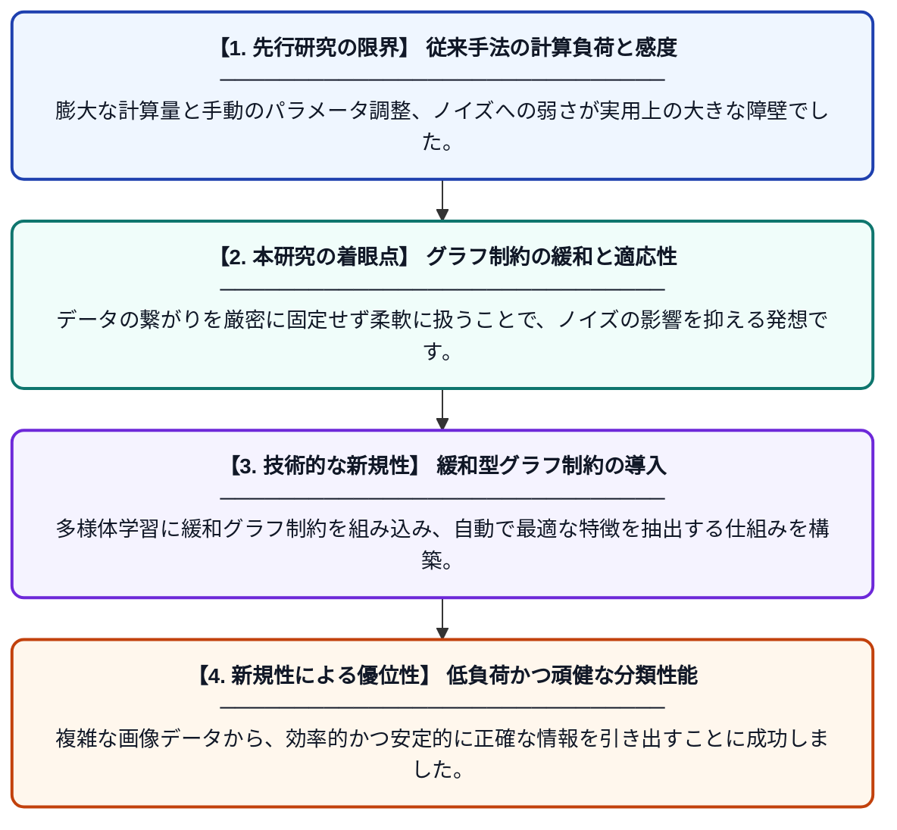

# ハイパースペクトル画像のための緩和グラフ制約多様体を用いた教師あり次元削減

**Original Title**: *Supervised dimensionality reduction with a relaxed graph-constrained manifold for hyperspectral imagery*

> **💡 一言要約**: ノイズに強く高速な超多波長画像解析の新手法

| 項目 | 内容 |
|---|---|
| **著者** | G Yang, K Chen, H Su, N Wang |
| **掲載誌** | Journal of Applied Remote Sensing 2026 |
| **アラートキーワード** | manifold learning |
| **原文リンク** | [https://www.spiedigitallibrary.org/journals/journal-of-applied-remote-sensing/volume-20/issue-4/041606/Supervised-dimensionality-reduction-with-a-relaxed-graph-constrained-manifold-for/10.1117/1.JRS.20.041606.short](https://www.spiedigitallibrary.org/journals/journal-of-applied-remote-sensing/volume-20/issue-4/041606/Supervised-dimensionality-reduction-with-a-relaxed-graph-constrained-manifold-for/10.1117/1.JRS.20.041606.short) |
| **PDF版要約** | [README.pdf](./README.pdf) |

---

## 📊 新規性の図解（先行研究との違いと本研究のブレークスルー）

## 📝 要約

ハイパースペクトル画像の分類精度を向上させるため、計算負荷が低くノイズに強い新しい次元削減手法を提案しています。局所的な構造を維持しつつグラフ制約を緩和することで、従来の多様体学習が抱えていた計算の複雑さとパラメータ依存の問題を解決しました。

## ❓ どんな問題に取り組んだか

従来の多様体学習アルゴリズムは、計算コストが高く、パラメータを手動で設定する必要があるという課題がありました。また、ノイズに対して敏感であり、複雑なハイパースペクトルデータの分類において精度が低下しやすい点も大きな問題でした。

## ✨ 何が新しい？何がすごい？（新規性）

本研究は、グラフ制約を「緩和」することで、データの微細な変動やノイズを許容しながら重要な特徴を抽出する新しいフレームワークを導入しました。先行研究が固定的なグラフ構造に依存していたのに対し、本手法はデータに適応的なグラフ構築を行い、パラメータ調整の負担を大幅に軽減しています。これにより、計算効率を改善しつつ、分類精度の向上とノイズに対する堅牢性を両立させることに成功しました。

## 🎓 大学1年生向けの解説

ハイパースペクトル画像とは、目に見えない光まで細かく捉えた非常に情報量の多い画像のことです。情報が多すぎると解析が大変なため、「大事な情報だけを残してデータを小さくする」技術が必要ですが、これまでは計算に時間がかかったりノイズに弱かったりしました。この研究では、データのつながりを「ゆるく」捉える工夫をすることで、素早く正確に画像の中身を判別できるようにしました。これにより、複雑なデータからでも効率的に物質や地表の情報を特定できるようになります。
