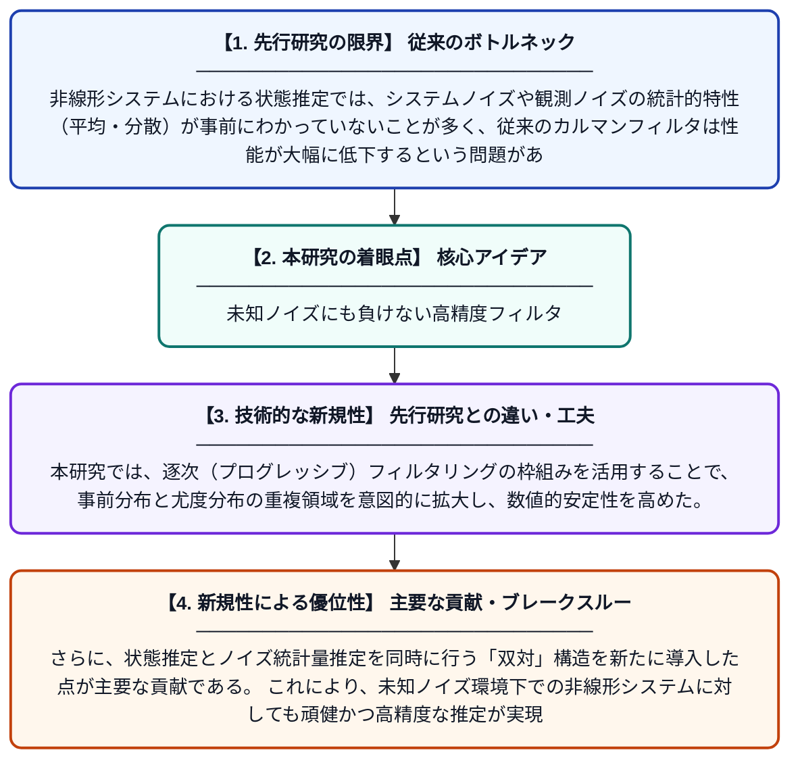

# 未知ノイズを持つ非線形システムのための双対逐次拡張カルマンフィルタ

**Original Title**: *A Dual Progressive Extended Kalman Filter for Nonlinear Systems With Unknown Noises*

> **💡 一言要約**: 未知ノイズにも負けない高精度フィルタ

| 項目 | 内容 |
|---|---|
| **著者** | X Chen, P Lin, Y Qian, L Zhu |
| **掲載誌** | International Journal of Robust and Nonlinear Control 2026 |
| **アラートキーワード** | kalman filter |
| **原文リンク** | [https://onlinelibrary.wiley.com/doi/abs/10.1002/rnc.70677](https://onlinelibrary.wiley.com/doi/abs/10.1002/rnc.70677) |
| **PDF版要約** | [README.pdf](./README.pdf) |

---

## 📊 新規性の図解（先行研究との違いと本研究のブレークスルー）

## 📝 要約

本論文は、システムノイズと観測ノイズが未知である非線形システムに対して、逐次フィルタリングの枠組みに基づく双対拡張カルマンフィルタを提案する。事前分布と尤度分布の重複領域を拡大することで、フィルタリングの精度と安定性を向上させることを目的としている。提案手法は、未知ノイズ統計量の推定と状態推定を同時に行う双対構造を採用している。

## ❓ どんな問題に取り組んだか

非線形システムにおける状態推定では、システムノイズや観測ノイズの統計的特性（平均・分散）が事前にわかっていないことが多く、従来のカルマンフィルタは性能が大幅に低下するという問題がある。また、非線形性が強い場合、事前分布と尤度分布の重複が小さくなり、フィルタが発散しやすいという課題も存在する。

## ✨ 何が新しい？何がすごい？（新規性）

従来の拡張カルマンフィルタは既知のノイズ統計量を前提としており、未知ノイズへの対応が困難であった。本研究では、逐次（プログレッシブ）フィルタリングの枠組みを活用することで、事前分布と尤度分布の重複領域を意図的に拡大し、数値的安定性を高めた。さらに、状態推定とノイズ統計量推定を同時に行う「双対」構造を新たに導入した点が主要な貢献である。これにより、未知ノイズ環境下での非線形システムに対しても頑健かつ高精度な推定が実現可能となった。

## 🎓 大学1年生向けの解説

カルマンフィルタとは、センサーのノイズが混じった観測データから、物体の本当の位置や速度などを推定する数学的な手法です。しかし、現実ではノイズの大きさ自体がわからないことが多く、そのままでは精度が落ちてしまいます。この研究では、「ノイズの大きさを学びながら同時に状態を推定する」という二段構えの賢い仕組みを考案しました。さらに、推定の計算が不安定になりやすい問題を「分布を少しずつ近づける」という工夫で解決しています。結果として、ノイズが未知でも正確に状態推定できるフィルタが実現されました。
