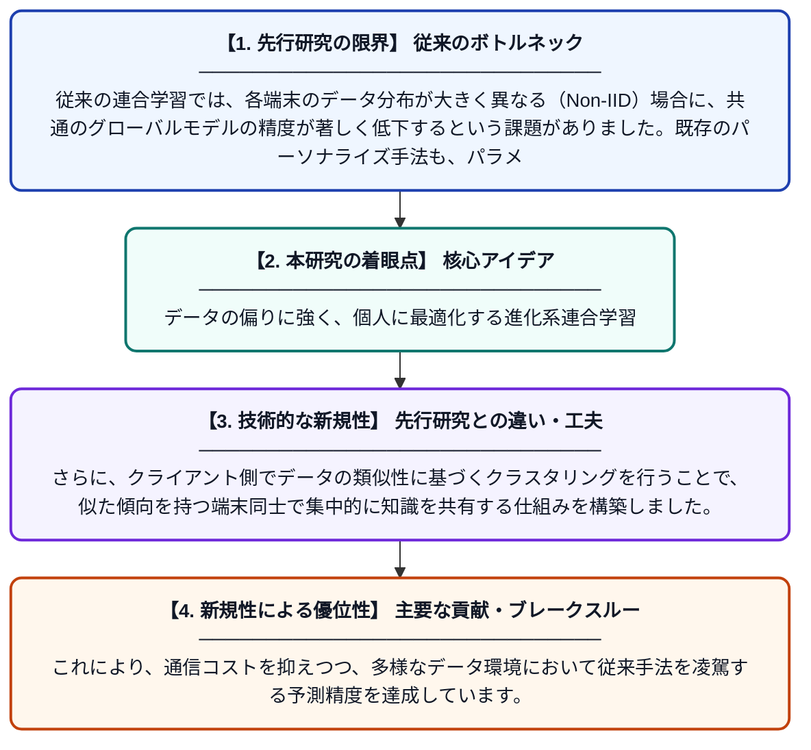

# FedACC：適応的パラメータ分離とクライアント側クラスタリングによるパーソナライズされた連合学習

**Original Title**: *FedACC: personalized federated learning via adaptive parameter decoupling and client-side clustering*

> **💡 一言要約**: データの偏りに強く、個人に最適化する進化系連合学習

| 項目 | 内容 |
|---|---|
| **著者** | X Yang, J Wu |
| **掲載誌** | Cluster Computing 2026 |
| **アラートキーワード** | Federated Learning |
| **原文リンク** | [https://link.springer.com/article/10.1007/s10586-026-06702-9](https://link.springer.com/article/10.1007/s10586-026-06702-9) |
| **PDF版要約** | [README.pdf](./README.pdf) |

---

## 📊 新規性の図解（先行研究との違いと本研究のブレークスルー）

## 📝 要約

データ分布が異なるクライアント間でも高精度な学習を可能にする「FedACC」を提案しています。モデルのパラメータを適応的に分離し、類似したクライアントをグループ化することで、個々のユーザーに最適化されたモデルを効率的に構築します。

## ❓ どんな問題に取り組んだか

従来の連合学習では、各端末のデータ分布が大きく異なる（Non-IID）場合に、共通のグローバルモデルの精度が著しく低下するという課題がありました。既存のパーソナライズ手法も、パラメータの分離が静的であったり、クライアント間の協力関係を十分に活用できなかったりする限界がありました。

## ✨ 何が新しい？何がすごい？（新規性）

本論文の核心は、学習状況に応じて共有パラメータと個人用パラメータの比率を動的に調整する「適応的パラメータ分離」を導入した点にあります。さらに、クライアント側でデータの類似性に基づくクラスタリングを行うことで、似た傾向を持つ端末同士で集中的に知識を共有する仕組みを構築しました。これにより、通信コストを抑えつつ、多様なデータ環境において従来手法を凌駕する予測精度を達成しています。

## 🎓 大学1年生向けの解説

「連合学習」は、みんなのデータを1か所に集めずに、各自のスマホなどでAIを賢くする技術ですが、人によってデータの傾向が違うとうまく学習できない弱点がありました。この研究では、AIを「みんなで共有する部分」と「自分専用の部分」に賢く切り分け、さらに似た者同士のグループで教え合う仕組みを作りました。その結果、プライバシーを守りながら、自分にぴったりの高性能なAIを効率よく作れるようになりました。
