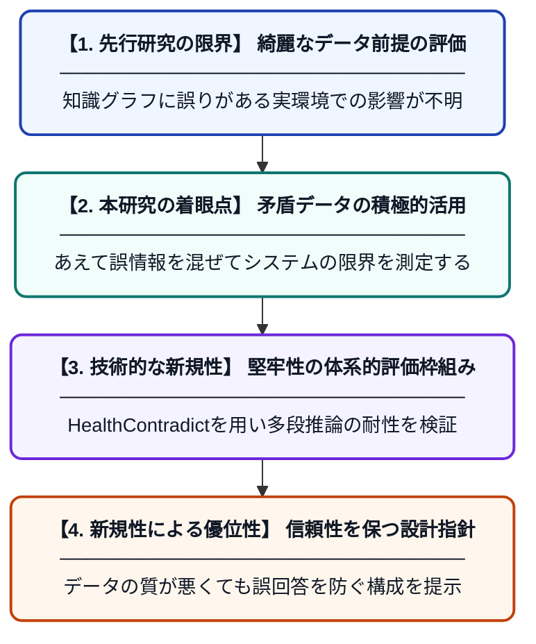

# 不正確なデータが存在する環境における知識グラフRAGアーキテクチャの堅牢性評価

**Original Title**: *Assessing the Robustness of Knowledge Graph RAG Architectures in the Presence of Incorrect Data*

> **💡 一言要約**: 誤情報に負けない知識グラフRAGの強さを徹底検証

| 項目 | 内容 |
|---|---|
| **著者** | Z Grider, A Abburi, A Nelson |
| **掲載誌** | 2026 |
| **アラートキーワード** | graph rag |
| **PDF** | [https://ceur-ws.org/Vol-4312/paper30.pdf](https://ceur-ws.org/Vol-4312/paper30.pdf) |
| **Git リポジトリ** | [https://github.com/AESIRLab/graphRAG-reasoning.4](https://github.com/AESIRLab/graphRAG-reasoning.4) |
| **原文リンク** | [https://ceur-ws.org/Vol-4312/paper30.pdf](https://ceur-ws.org/Vol-4312/paper30.pdf) |
| **PDF版要約** | [README.pdf](./README.pdf) |

---

## 📊 新規性の図解（先行研究との違いと本研究のブレークスルー）

## 📝 要約

知識グラフを用いた検索拡張生成（KG-RAG）が、誤った情報や矛盾するデータに対してどの程度の耐性を持つかを体系的に調査した論文です。HealthContradictデータセットを用いて、不正確なデータが混入した際でもハルシネーションを抑制し、正確な多段推論を維持できるかを評価しています。

## ❓ どんな問題に取り組んだか

RAGシステムは外部知識を参照して正確性を高めますが、その参照元である知識グラフ自体に誤りや矛盾が含まれている場合の影響は十分に解明されていません。特に医療分野のように正確性が不可欠な領域では、不完全なデータが推論結果を歪め、深刻なハルシネーションを引き起こすリスクがあります。

## ✨ 何が新しい？何がすごい？（新規性）

本研究は、知識グラフを活用したRAGの「データの不正確さに対する堅牢性」に焦点を当て、HealthContradictという矛盾を含むデータセットを用いて定量的な評価を実現した点が新規性です。先行研究の多くが知識の網羅性や推論能力の向上を目的としていたのに対し、本研究は実運用で避けられない「低品質なデータへの耐性」を評価の主軸に置いています。これにより、データのノイズが推論プロセスに与える具体的な影響を明らかにし、より信頼性の高いRAGアーキテクチャの設計指針を提示しました。

## 🎓 大学1年生向けの解説

AIが質問に答えるとき、専門的な「知識の地図（知識グラフ）」をカンニングペーパーとして使う技術があります。しかし、もしそのカンニングペーパーにわざと間違ったことが書かれていたら、AIは騙されてしまうでしょうか。この研究では、あえて間違いや矛盾を混ぜたデータを使って、AIがどこまで正しく判断できるかをテストしました。これにより、どんなに情報が乱れていても、正解を見抜ける賢いAIを作るためのヒントを探っています。
