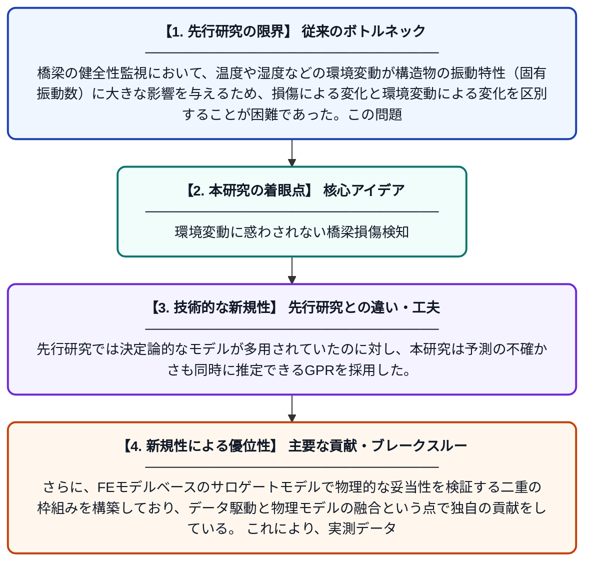

# 環境変動下における単径間プレストレストコンクリート桁橋の損傷検知：物理シミュレーションで検証されたガウス過程回帰の適用

**Original Title**: *Damage detection in a single-span prestressed concrete girder bridge under environmental variations using Gaussian process regression validated by physics …*

> **💡 一言要約**: 環境変動に惑わされない橋梁損傷検知

| 項目 | 内容 |
|---|---|
| **著者** | H Ahmad, Y Matsumoto |
| **掲載誌** | Journal of Civil Structural Health Monitoring 2026 |
| **アラートキーワード** | gaussian process |
| **原文リンク** | [https://link.springer.com/article/10.1007/s13349-026-01090-5](https://link.springer.com/article/10.1007/s13349-026-01090-5) |
| **PDF版要約** | [README.pdf](./README.pdf) |

---

## 📊 新規性の図解（先行研究との違いと本研究のブレークスルー）

## 📝 要約

本研究では、環境パラメータを用いて固有振動数とその不確かさを予測するガウス過程回帰（GPR）モデルを開発し、橋梁の損傷検知に応用した。さらに、有限要素（FE）モデルを用いたGPRベースのサロゲートモデルを構築し、物理シミュレーションによる検証を行った。温度変化などの環境変動が振動特性に与える影響を適切に分離することで、より信頼性の高い損傷検知を実現している。

## ❓ どんな問題に取り組んだか

橋梁の健全性監視において、温度や湿度などの環境変動が構造物の振動特性（固有振動数）に大きな影響を与えるため、損傷による変化と環境変動による変化を区別することが困難であった。この問題により、従来手法では損傷の見逃しや誤検知が生じるリスクがあった。

## ✨ 何が新しい？何がすごい？（新規性）

本研究の新規性は、GPRを用いて環境変動の影響を確率的に定量化・除去しながら損傷検知を行う点にある。先行研究では決定論的なモデルが多用されていたのに対し、本研究は予測の不確かさも同時に推定できるGPRを採用した。さらに、FEモデルベースのサロゲートモデルで物理的な妥当性を検証する二重の枠組みを構築しており、データ駆動と物理モデルの融合という点で独自の貢献をしている。これにより、実測データが少ない状況でも信頼性の高い損傷診断が可能となった。

## 🎓 大学1年生向けの解説

橋が古くなったり傷んだりすると、橋の「揺れやすさ（固有振動数）」が変化します。しかし、気温が変わるだけでも揺れやすさは変化するため、『損傷のせいなのか、気温のせいなのか』を見分けるのがとても難しい問題です。この研究では、ガウス過程回帰という機械学習の手法を使って、気温などの環境変化による影響を取り除き、本当の損傷だけを検出できる方法を開発しました。さらに、コンピュータ上で橋を再現したシミュレーション（有限要素モデル）を使って、その方法が正しく機能するか確認しています。これにより、橋の安全を見守るシステムがより正確になることが期待されます。
