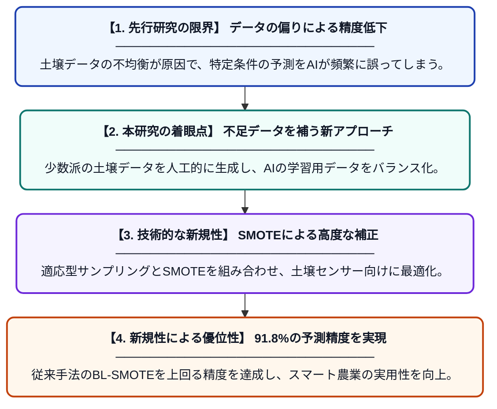

# スマート農業センサーのための適応型サンプリングと機械学習を用いた土壌肥沃度予測フレームワーク

**Original Title**: *Adaptive Sampling and Machine Learning-Based Soil Fertility Prediction Framework for Smart Agriculture Sensors*

> **💡 一言要約**: AIとデータ補正技術で土壌の健康度を91.8%の精度で予測

| 項目 | 内容 |
|---|---|
| **著者** | S Behera, N Padhy |
| **掲載誌** | Engineering Proceedings 2026 |
| **アラートキーワード** | SMOTE |
| **PDF** | [https://www.mdpi.com/2673-4591/163/1/114/pdf](https://www.mdpi.com/2673-4591/163/1/114/pdf) |
| **原文リンク** | [https://www.mdpi.com/2673-4591/163/1/114/pdf](https://www.mdpi.com/2673-4591/163/1/114/pdf) |
| **PDF版要約** | [README.pdf](./README.pdf) |

---

## 📊 新規性の図解（先行研究との違いと本研究のブレークスルー）

## 📝 要約

スマート農業における土壌肥沃度を正確に予測するため、機械学習とデータ不均衡を解消する技術を組み合わせた新しいフレームワークが提案されました。SMOTEなどのオーバーサンプリング技術を活用することで、データの偏りを克服し、91.80%という極めて高い予測精度を達成しています。

## ❓ どんな問題に取り組んだか

農業現場で収集される土壌データは、特定の土壌タイプに偏りがある「クラス不均衡」が頻繁に発生します。この偏りにより、従来の機械学習モデルでは少数派の重要な土壌条件を正しく認識できず、予測精度が低下するという課題がありました。

## ✨ 何が新しい？何がすごい？（新規性）

本研究の核心は、適応型サンプリング技術とSMOTE（Synthetic Minority Over-sampling Technique）を統合し、データの不均衡を動的に解消する点にあります。先行研究と比較して、SMOTEとBL-SMOTEの効果を厳密に検証し、SMOTEが91.80%の精度で最も優れた性能を示すことを明らかにしました。これにより、少数のデータからでも信頼性の高い土壌肥沃度予測が可能になりました。

## 🎓 大学1年生向けの解説

美味しい野菜を作るには、土がどれくらい栄養（肥沃度）を持っているかを知ることが不可欠です。しかし、土のデータを集めると、どうしても特定の種類のデータばかりが集まり、珍しい土の状態をAIが学習しにくいという問題がありました。この研究では、足りないデータを数学的な工夫で作り出し、AIが土の状態をより公平に学べるようにしました。その結果、センサーからの情報をもとに土の健康状態を非常に正確に当てられるようになりました。
