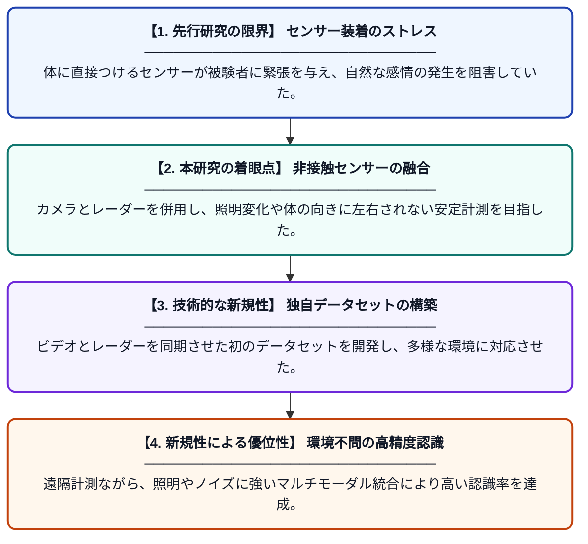

# RemoPhysEmo：ビデオとレーダーによる遠隔計測生体信号を用いたマルチモーダル感情データセット

**Original Title**: *RemoPhysEmo: A Multimodal Emotion Dataset with Remotely Sensed Physiological Signals via Video and Radar*

> **💡 一言要約**: ビデオとレーダーで、非接触に心の動きを読み解く

| 項目 | 内容 |
|---|---|
| **著者** | Z Gao, X Li, J Ge, H Zou, J Zheng, L Lu, F Lin, J Feng… |
| **掲載誌** | Proceedings of the 34th … 2026 |
| **アラートキーワード** | affective computing |
| **原文リンク** | [https://dl.acm.org/doi/abs/10.1145/3767308.3838666](https://dl.acm.org/doi/abs/10.1145/3767308.3838666) |
| **PDF版要約** | [README.pdf](./README.pdf) |

---

## 📊 新規性の図解（先行研究との違いと本研究のブレークスルー）

## 📝 要約

ビデオカメラとミリ波レーダーを用い、身体に触れることなく心拍や呼吸などの生体信号を計測して感情を推定する新しいデータセットを提案しました。複数の非接触センサーを組み合わせることで、従来の接触型センサーに伴う不快感を排除しつつ、高い精度での感情認識を可能にしています。

## ❓ どんな問題に取り組んだか

従来の感情認識研究では、体に電極を貼る接触型センサーが主流でしたが、装着による不快感が自然な感情の変化を妨げるという課題がありました。また、カメラのみの非接触手法は暗闇などの照明環境に弱く、安定したデータ取得が困難でした。

## ✨ 何が新しい？何がすごい？（新規性）

本研究の最大の特徴は、ビデオとミリ波レーダーという異なる性質のセンサーを融合させた世界初の大規模データセット「RemoPhysEmo」を構築した点にあります。レーダーは照明の影響を受けずに微細な胸の動きを捉え、ビデオは顔の表面の血流変化（rPPG）を捉えるため、両者を統合することで互いの欠点を補完できます。このマルチモーダルなアプローチにより、非接触でありながら接触型センサーに匹敵する、あるいはそれを超える感情認識精度を実現しました。

## 🎓 大学1年生向けの解説

人の気持ちを読み取るAIを作る際、これまでは体にベタベタとセンサーを貼る必要があり、それがストレスになって自然な感情が測れないという矛盾がありました。この研究では、カメラとレーダーを使って、離れた場所から心拍数や呼吸を測ることで、その問題を解決しています。たとえ部屋が暗くてもレーダーがカバーしてくれるため、どんな場所でも使えるのがすごいところです。将来的に、家の中でさりげなく私たちの体調や気分を見守ってくれるAIの開発に役立つ技術です。
