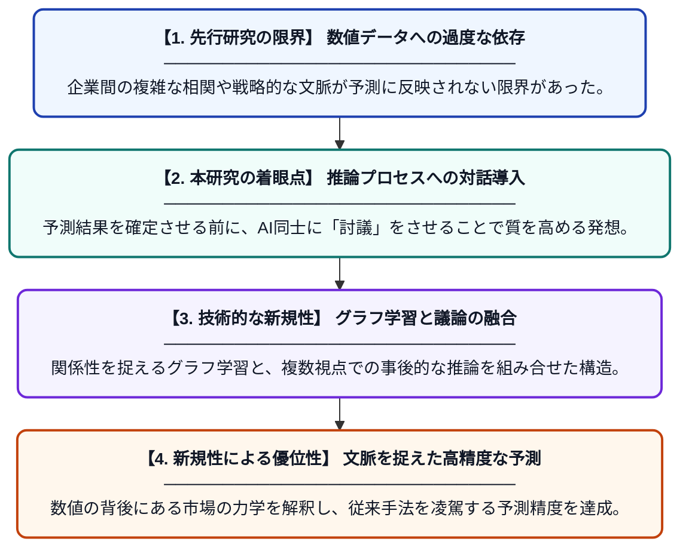

# グラフ学習とマルチエージェント推論を用いた企業間競争ダイナミクスの文脈を考慮した予測

**Original Title**: *Context-aware forecasting of inter-firm competitive dynamics with graph learning and multi-agent reasoning*

> **💡 一言要約**: AI同士の議論で企業の競争を読み解く次世代予測

| 項目 | 内容 |
|---|---|
| **著者** | D Park, Y Kwon, S Han, PD Yoo |
| **掲載誌** | Scientific Reports 2026 |
| **アラートキーワード** | multi agent |
| **PDF** | [https://www.nature.com/articles/s41598-026-79480-4_reference.pdf](https://www.nature.com/articles/s41598-026-79480-4_reference.pdf) |
| **原文リンク** | [https://www.nature.com/articles/s41598-026-79480-4_reference.pdf](https://www.nature.com/articles/s41598-026-79480-4_reference.pdf) |
| **PDF版要約** | [README.pdf](./README.pdf) |

---

## 📊 新規性の図解（先行研究との違いと本研究のブレークスルー）

## 📝 要約

企業間の複雑な関係性と時系列データを統合し、マルチエージェントによる議論プロセスを通じて予測精度を高める新しいフレームワークを提案しています。グラフ学習で構造的なつながりを捉えつつ、複数のAIエージェントが予測結果を検証・討議することで、従来の数値的手法では困難だった市場の文脈理解を実現しました。

## ❓ どんな問題に取り組んだか

従来の企業間競争予測は、過去の数値データに過度に依存しており、企業同士の複雑な取引関係や戦略的な意図といった「文脈」を十分に反映できていませんでした。その結果、急激な市場環境の変化や、相互に影響し合う動的な競争関係を正確に捉えられないという課題がありました。

## ✨ 何が新しい？何がすごい？（新規性）

本研究の核心は、時系列予測モデルに「マルチエージェントによる事後的な議論（Multi-agent Debate）」を導入した点にあります。グラフ学習によって抽出された企業間の相関関係に基づき、予測結果に対して複数のエージェントが異なる視点から推論・修正を行うプロセスを構築しました。これにより、単一のAIモデルでは見落とされがちな情報の矛盾を解消し、構造的な文脈に基づいた高度な意思決定支援が可能になりました。

## 🎓 大学1年生向けの解説

ライバル企業が次にどんな行動をとるか予測するのは非常に難しい問題です。この研究では、AIにただ計算させるだけでなく、複数のAIエージェントに「この予測は正しいか？」と会議をさせるような仕組みを作りました。まず、企業同士のネットワークを分析して基礎的な予測を立て、その結果についてAIたちが話し合うことで、より人間らしい深い洞察を加えます。これにより、単なる数字の羅列からでは分からない、企業の複雑な駆け引きまで予測できるようになります。
