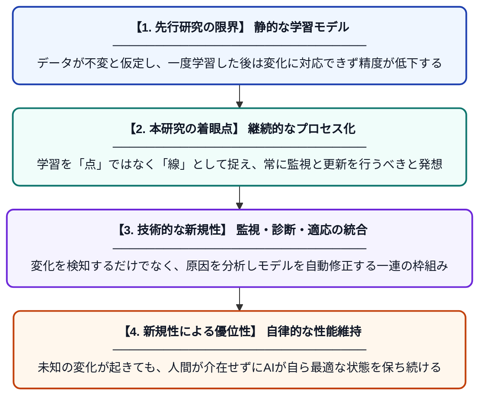

# 時間とともに変化するデータからの学習：リアルタイムデータマイニングの個人的ビジョン

**Original Title**: *Learning from Time-Evolving Data: A personal vision of Real-Time Data Mining*

> **💡 一言要約**: 学習は一度きりではなく、進化し続けるプロセスである

| 項目 | 内容 |
|---|---|
| **著者** | J Gama |
| **掲載誌** | 2026 |
| **アラートキーワード** | one shot |
| **原文リンク** | [https://comum.rcaap.pt/entities/publication/155c3497-5980-4445-a9e9-36a541433e89](https://comum.rcaap.pt/entities/publication/155c3497-5980-4445-a9e9-36a541433e89) |
| **PDF版要約** | [README.pdf](./README.pdf) |

---

## 📊 新規性の図解（先行研究との違いと本研究のブレークスルー）

## 📝 要約

時間の経過とともに性質が変化するデータ環境において、機械学習を一度限りのイベントではなく、継続的なプロセスとして捉える重要性を説いています。モデルの監視、診断、そして適応を繰り返すことで、動的な世界に追従し続けるリアルタイムデータマイニングの将来像を提示しています。

## ❓ どんな問題に取り組んだか

従来の機械学習の多くは、データが静的であることを前提とした「一度きりの学習」に依存しており、時間の経過とともにデータの傾向が変わる「コンセプトドリフト」に対応できません。これにより、時間の経過とともに予測精度が劣化し、現実世界の動的な変化に対応できないという課題がありました。

## ✨ 何が新しい？何がすごい？（新規性）

本論文の新規性は、学習を単なるモデル構築ではなく、監視・診断・適応という3つの要素を統合した「継続的なライフサイクル」として定義した点にあります。先行研究が個別のドリフト検知アルゴリズムに集中していたのに対し、本研究はシステムが自律的に変化を検知し、その原因を特定して自己修正を行う包括的なアーキテクチャを提唱しました。これにより、リアルタイムデータマイニングにおける理論的枠組みを大きく前進させています。

## 🎓 大学1年生向けの解説

皆さんの好みが年齢とともに変わるように、世の中のデータも常に変化しています。昔のデータだけで作ったAIは、今の状況には合わなくなってしまうのです。この論文は、AIを一度作って終わりにするのではなく、常に「今の状況」を見守り、変化に合わせて自分をアップデートし続ける仕組みを提案しています。まるで生き物のように、環境に合わせて成長し続けるAIの作り方を解説しています。
