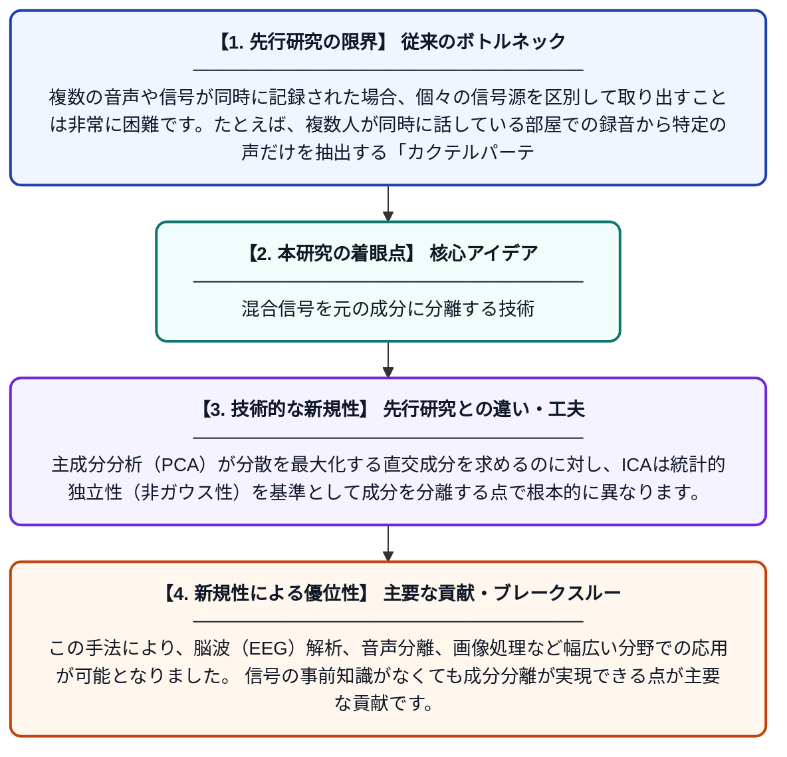

# 独立成分分析

**Original Title**: *Independent Component Analysis*

> **💡 一言要約**: 混合信号を元の成分に分離する技術

| 項目 | 内容 |
|---|---|
| **著者** | WHPFB ICA |
| **アラートキーワード** | independent component ... |
| **原文リンク** | [https://www.emotiv.com/neuroscience/independent-component-analysis](https://www.emotiv.com/neuroscience/independent-component-analysis) |
| **PDF版要約** | [README.pdf](./README.pdf) |

---

## 📊 新規性の図解（先行研究との違いと本研究のブレークスルー）

## 📝 要約

現実世界では、録音・記録されたデータは複数の信号源が同時に作用した結果として得られることが多く、そのままでは解析が困難です。独立成分分析（ICA）は、代数的変換を用いてこの混合信号を統計的に独立な成分へと分離する手法です。これにより、元の信号源を推定・復元することが可能になります。

## ❓ どんな問題に取り組んだか

複数の音声や信号が同時に記録された場合、個々の信号源を区別して取り出すことは非常に困難です。たとえば、複数人が同時に話している部屋での録音から特定の声だけを抽出する「カクテルパーティー問題」はその典型例です。従来の手法では、このような複雑な信号の混合を効果的に解析することが難しいという課題がありました。

## ✨ 何が新しい？何がすごい？（新規性）

ICAは、信号が統計的に独立であるという前提のもと、観測された混合信号から元の独立成分を数学的に分離できる点が革新的です。主成分分析（PCA）が分散を最大化する直交成分を求めるのに対し、ICAは統計的独立性（非ガウス性）を基準として成分を分離する点で根本的に異なります。この手法により、脳波（EEG）解析、音声分離、画像処理など幅広い分野での応用が可能となりました。信号の事前知識がなくても成分分離が実現できる点が主要な貢献です。

## 🎓 大学1年生向けの解説

たとえば、複数の人が同時に話している部屋でマイクを使って録音すると、全員の声が混ざった音声データが得られます。独立成分分析（ICA）とは、この混ざった音声から「誰がどんな声を出しているか」を自動的に分けて取り出す技術です。数学的な変換を使って、統計的にバラバラ（独立）な成分を見つけ出すのがポイントです。難しい事前知識がなくても信号を分離できるため、医療や音声認識など多くの場面で活躍しています。
