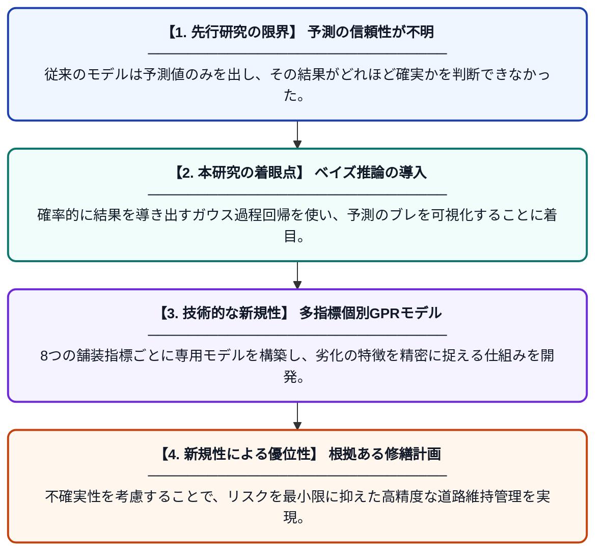

# ガウス過程回帰に基づく不確実性を考慮した舗装性能予測

**Original Title**: *Uncertainty-aware pavement performance prediction based on Gaussian process regression*

> **💡 一言要約**: 不確実性も予測する、AIによる賢い道路の劣化診断

| 項目 | 内容 |
|---|---|
| **著者** | L Yao, Z Song, J Jiang |
| **掲載誌** | Structure and Infrastructure Engineering 2026 |
| **アラートキーワード** | gaussian process |
| **原文リンク** | [https://www.tandfonline.com/doi/abs/10.1080/15732479.2026.2755858](https://www.tandfonline.com/doi/abs/10.1080/15732479.2026.2755858) |
| **PDF版要約** | [README.pdf](./README.pdf) |

---

## 📊 新規性の図解（先行研究との違いと本研究のブレークスルー）

## 📝 要約

この研究は、ガウス過程回帰（GPR）という手法を用いて、舗装の劣化状態を予測すると同時にその予測の「不確実性」を数値化するモデルを開発しました。8つの異なる舗装指標に対して個別のモデルを構築し、将来のメンテナンス計画の信頼性を高めることを可能にしています。

## ❓ どんな問題に取り組んだか

従来の舗装劣化予測モデルは予測値のみを算出することが多く、その予測がどの程度信頼できるかという不確実性を評価できていませんでした。そのため、予測の誤差を考慮した柔軟なメンテナンス計画の策定が困難であるという課題がありました。

## ✨ 何が新しい？何がすごい？（新規性）

ノンパラメトリックなベイズ推論手法であるガウス過程回帰を採用し、予測値とともにその分散（不確実性）を明示的に算出できる点が最大の特徴です。先行研究の多くが単一のモデルに依存していたのに対し、本研究では8つの舗装指標ごとに最適化された個別モデルを構築しました。これにより、複雑な劣化傾向を柔軟に学習し、データが不足している領域での予測リスクを可視化することに成功しています。

## 🎓 大学1年生向けの解説

道路の舗装は時間が経つと劣化しますが、それを完璧に予測するのは非常に難しいことです。この研究では、AIを使って「いつ道が壊れるか」だけでなく「その予測がどれくらい確実か」という自信の度合いも一緒に計算できるようにしました。予測の自信のなさがわかれば、早めに点検に行くなどの対策が立てやすくなります。これにより、より安全で効率的な道路の管理ができるようになります。
