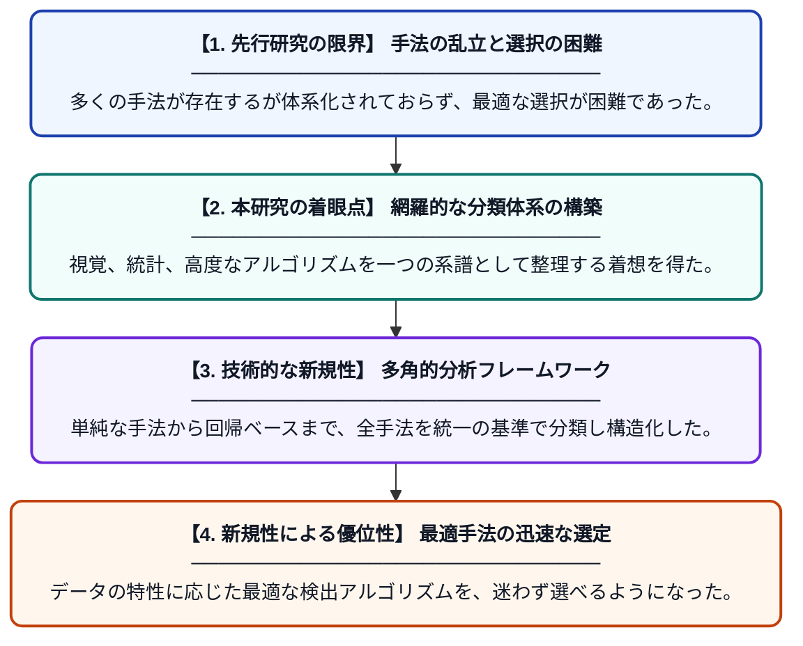

# 外れ値検出手法のレビュー：視覚的検査から高度なアルゴリズムまで

**Original Title**: *A Review of Outlier Detection Methods: From Visual Inspection to Advanced Algorithms*

> **💡 一言要約**: 視覚からAIまで、外れ値検出の決定版ガイド

| 項目 | 内容 |
|---|---|
| **著者** | F Madadizadeh, S Bahariniya |
| **掲載誌** | The Open Public Health Journal 2026 |
| **アラートキーワード** | kernel density estimation |
| **原文リンク** | [https://openpublichealthjournal.com/VOLUME/19/ELOCATOR/e187494451563/FULLTEXT/](https://openpublichealthjournal.com/VOLUME/19/ELOCATOR/e187494451563/FULLTEXT/) |
| **PDF版要約** | [README.pdf](./README.pdf) |

---

## 📊 新規性の図解（先行研究との違いと本研究のブレークスルー）

## 📝 要約

本論文は、データ分析における外れ値検出手法を体系的に整理したレビューです。箱ひげ図などの視覚的な基本手法から、Zスコアや回帰分析といった統計的手法、さらには高度なアルゴリズムまでを網羅し、その分類と適用範囲を明確に示しています。

## ❓ どんな問題に取り組んだか

データ分析において、外れ値は統計的な推論を歪める大きな要因となりますが、その検出手法は多岐にわたります。分析者が自分のデータに対して、どの手法が最も適切であるかを判断するための統一的な指針が不足しているという課題がありました。

## ✨ 何が新しい？何がすごい？（新規性）

本研究の新規性は、古典的な視覚的アプローチから最新の計算アルゴリズムまでを、一つの体系化された「タクソノミー（分類学）」として統合した点にあります。先行研究が特定の手法に偏りがちだったのに対し、本論文はパラメトリック、ノンパラメトリック、回帰ベースなど、手法ごとの数学的背景と実用性を横断的に比較しています。これにより、公衆衛生学をはじめとする多様な分野で活用できる実践的なフレームワークを提示したことが大きな貢献です。

## 🎓 大学1年生向けの解説

データの中に、他の値とは大きく離れた「おかしな値（外れ値）」が混ざっていると、全体の平均などが狂って正しく分析できません。この論文は、そのおかしな値を見つけるための「道具箱」の中身を整理して紹介しています。簡単なグラフでパッと見て探す方法から、難しい数式を使って精密に見つける方法まで、それぞれの道具の使い分けが学べるようになっています。
