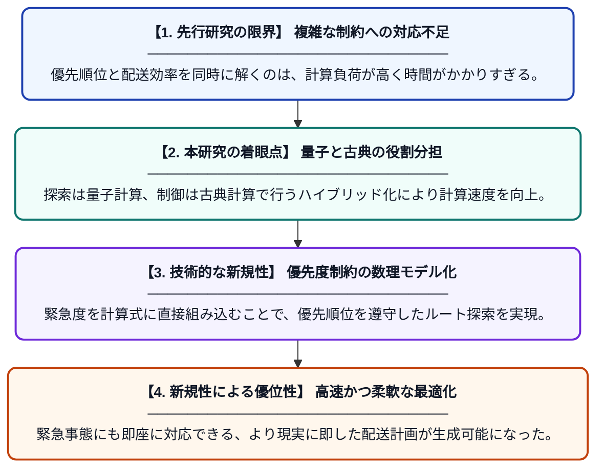

# 優先度制約を考慮した都市物流ルート最適化のための量子・古典ハイブリッドフレームワーク

**Original Title**: *A Hybrid Quantum-Classical Framework for Priority Constrained Urban Logistics Routing*

> **💡 一言要約**: 量子×古典で解く、緊急物資優先の都市配送最適化

| 項目 | 内容 |
|---|---|
| **著者** | G Amulya, S Shajith, PSS Lakshmi, VS Raj, T Nagesh |
| **掲載誌** | … International Conference on … 2026 |
| **アラートキーワード** | logistics |
| **原文リンク** | [https://ieeexplore.ieee.org/abstract/document/11765278/](https://ieeexplore.ieee.org/abstract/document/11765278/) |
| **PDF版要約** | [README.pdf](./README.pdf) |

---

## 📊 新規性の図解（先行研究との違いと本研究のブレークスルー）

## 📝 要約

緊急物資を最優先に届けつつ、全体の配送効率も維持する都市物流のための新しい計算手法を提案しています。量子コンピュータと従来の古典コンピュータを組み合わせることで、複雑な優先順位制約を持つ配送ルート問題を効率的に解決します。

## ❓ どんな問題に取り組んだか

都市部の物流網では、緊急性の高い物資を優先しつつ、同時に通常の配送も効率的に行う必要があります。しかし、このような複雑な優先順位制約を含むルート最適化は計算量が膨大になり、従来のコンピュータだけでは最適な解を素早く見つけることが困難でした。

## ✨ 何が新しい？何がすごい？（新規性）

本研究の核心は、量子計算の並列探索能力と古典計算の安定性を融合させたハイブリッドフレームワークにあります。先行研究では考慮が不十分だった「厳格な優先度制約」を数理モデルに組み込み、量子ビットの重ね合わせを利用して膨大なルート候補から最適解を抽出します。これにより、実用的な時間内での高度な意思決定を可能にした点が大きな貢献です。

## 🎓 大学1年生向けの解説

街の中で荷物を運ぶとき、救急車のように「一刻も早く届けるべき場所」と「普通の荷物」が混ざると、ルート作りはとても難しいパズルになります。この研究は、未来の計算機である「量子コンピュータ」と普通のパソコンを協力させて、そのパズルを解く方法を考えました。これによって、大事な荷物を優先しながら、無駄のない一番いい道順をパッと見つけられるようになります。
