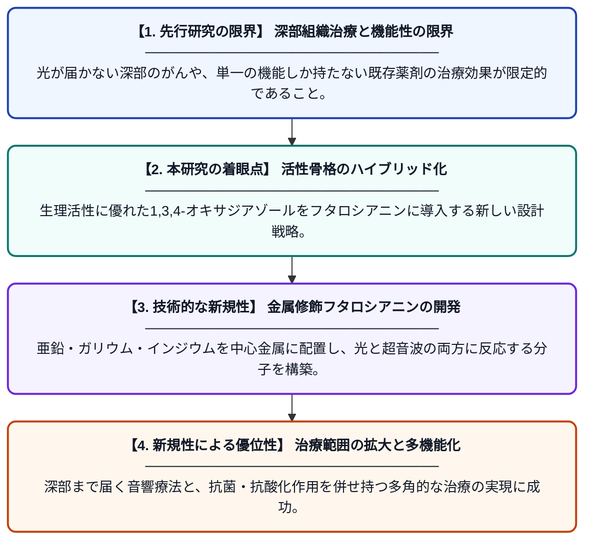

# 1,3,4-オキサジアゾール誘導体で修飾されたフタロシアニン：音響/光力学的療法、抗菌、抗がん、抗酸化活性を統合した多機能バイオアクティブ剤

**Original Title**: *1, 3, 4-Oxadiazole derivative-modified phthalocyanines as versatile bioactive agents: integration of sono/photodynamic with antimicrobial, anticancer, anti-oxidant …*

> **💡 一言要約**: 光と音で病気と戦う多機能フタロシアニン

| 項目 | 内容 |
|---|---|
| **著者** | B Karaca, A Günsel, G Gökçil, GY Atmaca, B Tüzün… |
| **掲載誌** | Inorganica Chimica Acta 2026 |
| **アラートキーワード** | ICA |
| **原文リンク** | [https://www.sciencedirect.com/science/article/pii/S002016932600455X](https://www.sciencedirect.com/science/article/pii/S002016932600455X) |
| **PDF版要約** | [README.pdf](./README.pdf) |

---

## 📊 新規性の図解（先行研究との違いと本研究のブレークスルー）

## 📝 要約

本研究では、1,3,4-オキサジアゾール誘導体を導入した新しい亜鉛(II)、ガリウム(III)、インジウム(III)フタロシアニン錯体を合成しました。これらの化合物は、光や超音波に反応して活性酸素を発生させる特性を持ち、がん細胞の抑制や高い抗菌・抗酸化活性を示す多機能な治療薬としての可能性が示されました。

## ❓ どんな問題に取り組んだか

既存の光力学的療法（PDT）は、光が届きにくい深部組織の治療に限界がありました。また、単一の機能に特化した薬剤が多く、抗菌や抗酸化といった複数の生物学的課題に同時に対応できる多機能な化合物の開発が求められていました。

## ✨ 何が新しい？何がすごい？（新規性）

本研究の新規性は、優れた生理活性を持つ1,3,4-オキサジアゾール骨格をフタロシアニン構造に統合した点にあります。この設計により、光を用いた治療だけでなく超音波を用いた治療（SDT）にも対応可能となり、深部組織への治療アプローチを強化しました。さらに、一つの化合物で抗がん・抗菌・抗酸化の3つの効果を高度に両立させた点が極めて画期的です。

## 🎓 大学1年生向けの解説

この研究は、特定の光や音（超音波）を当てると活性酸素を作り出して、悪い細胞や細菌をやっつける「多機能な薬」を作ったというものです。フタロシアニンという色素に、特殊な構造を組み合わせることで、光が届かない体の深い場所にある病気も治療できるようになりました。また、この薬はがんを倒すだけでなく、バイ菌を殺したり、体の酸化（サビ）を防いだりする力も持っています。
