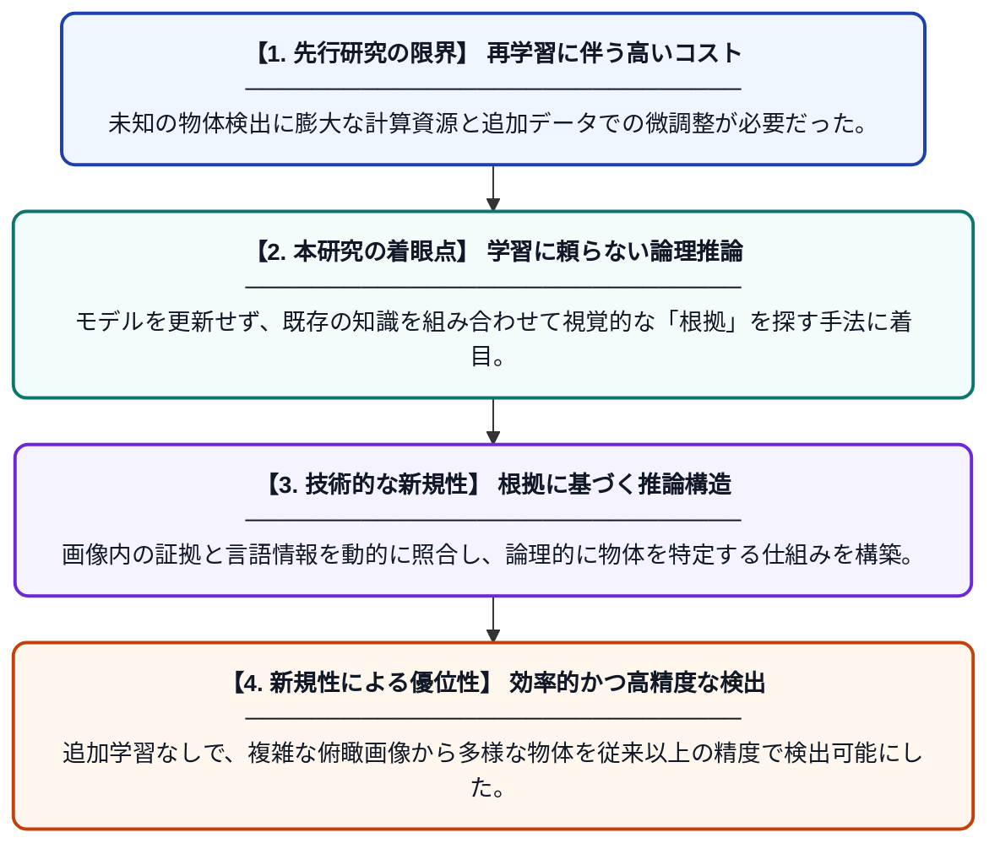

# リモートセンシングにおけるオープン語彙物体検出のための学習不要な根拠に基づく視覚推論

**Original Title**: *Training-Free Evidence-Grounded Visual Reasoning for Open-Vocabulary Object Detection in Remote Sensing*

> **💡 一言要約**: 追加学習なしで衛星画像から未知の物体を検出

| 項目 | 内容 |
|---|---|
| **著者** | G Zhu, B Yang, Y Zhuang, T Zhang, H Chen, L Li |
| **掲載誌** | 2026 |
| **アラートキーワード** | Open-Vocabulary Object ... |
| **原文リンク** | [https://www.preprints.org/manuscript/202611.0659](https://www.preprints.org/manuscript/202611.0659) |
| **PDF版要約** | [README.pdf](./README.pdf) |

---

## 📊 新規性の図解（先行研究との違いと本研究のブレークスルー）

## 📝 要約

リモートセンシング画像から任意の物体を検出する手法において、追加の学習を必要としない新しい推論フレームワークを提案しています。視覚的な根拠に基づいた推論プロセスを導入することで、複雑な俯瞰シーンでも高精度な物体認識を実現しました。

## ❓ どんな問題に取り組んだか

衛星などのリモートセンシング画像は俯瞰的な視点や複雑な背景を持つため、従来のモデルでは未知の物体を正確に特定することが困難でした。また、多くの既存手法は大規模な微調整（ファインチューニング）を必要とし、計算コストやデータ収集が大きな負担となっていました。

## ✨ 何が新しい？何がすごい？（新規性）

本研究の最大の特徴は、追加学習を一切行わない「トレーニングフリー」な手法でありながら、視覚的な根拠（エビデンス）に基づく推論を導入した点にあります。画像内の視覚的特徴と言語的な意味を論理的に結びつけることで、従来の微調整が必要なモデルに匹敵、あるいは凌駕する適応力を示しました。これにより、未知のカテゴリーに対しても柔軟かつ効率的な検出が可能になります。

## 🎓 大学1年生向けの解説

人工衛星やドローンで撮った写真から、あらかじめ教えていない新しい物体（建物や乗り物など）を見つけ出す技術についての研究です。これまでは、新しいものを見つけるためにコンピューターを何度も再教育する必要がありましたが、この研究では「再教育なし」で賢く推論する仕組みを作りました。写真の中にあるヒントを論理的に組み合わせることで、人間が推測するように物体を特定できるようになります。
