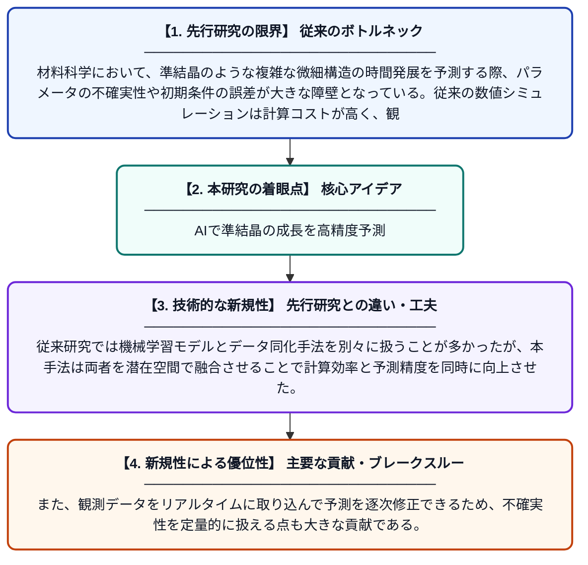

# β-VAE・トランスフォーマーとアンサンブルカルマンフィルタを用いた潜在空間同化フレームワークによる準結晶成長予測

**Original Title**: *A latent space assimilation framework for quasicrystal growth prediction using β-VAE–Transformer and Ensemble Kalman Filter*

> **💡 一言要約**: AIで準結晶の成長を高精度予測

| 項目 | 内容 |
|---|---|
| **著者** | J Feng, Z Lv, W Xie, Y Li |
| **掲載誌** | Physica A: Statistical Mechanics and its Applications 2026 |
| **アラートキーワード** | kalman filter |
| **原文リンク** | [https://www.sciencedirect.com/science/article/pii/S0378437126005984](https://www.sciencedirect.com/science/article/pii/S0378437126005984) |
| **PDF版要約** | [README.pdf](./README.pdf) |

---

## 📊 新規性の図解（先行研究との違いと本研究のブレークスルー）

## 📝 要約

不確かなパラメータや初期条件のもとでの微細構造進化を正確に予測することは困難な課題である。本研究では8次準結晶モデルを対象に、β変分オートエンコーダ（β-VAE）とトランスフォーマーを組み合わせたデータ駆動型モデルと、アンサンブルカルマンフィルタ（EnKF）によるデータ同化を統合した新しいフレームワークを提案する。これにより、不確実性を考慮しながら準結晶の成長過程をリアルタイムかつ高精度に予測することが可能となった。

## ❓ どんな問題に取り組んだか

材料科学において、準結晶のような複雑な微細構造の時間発展を予測する際、パラメータの不確実性や初期条件の誤差が大きな障壁となっている。従来の数値シミュレーションは計算コストが高く、観測データを効率的に取り込んで予測を修正する手段が乏しかった。特に8次の高次元偏微分方程式で記述される準結晶モデルは、直接シミュレーションが非常に困難である。

## ✨ 何が新しい？何がすごい？（新規性）

本研究の最大の新規性は、β-VAEによって高次元の微細構造データを低次元の潜在空間に圧縮し、その潜在空間上でトランスフォーマーによる時系列予測とアンサンブルカルマンフィルタによるデータ同化を行う統合フレームワークを初めて構築した点である。従来研究では機械学習モデルとデータ同化手法を別々に扱うことが多かったが、本手法は両者を潜在空間で融合させることで計算効率と予測精度を同時に向上させた。また、観測データをリアルタイムに取り込んで予測を逐次修正できるため、不確実性を定量的に扱える点も大きな貢献である。

## 🎓 大学1年生向けの解説

準結晶とは、通常の結晶とも非結晶とも異なる特殊な原子配列を持つ材料で、その成長過程をコンピュータで予測することはとても難しいです。この研究では、画像の特徴を圧縮するAI技術（VAE）と文章を理解するAI技術（トランスフォーマー）を組み合わせて、準結晶がどのように育つかを予測するモデルを作りました。さらに、天気予報でも使われる「カルマンフィルタ」という手法で、実際の観測データを使って予測をリアルタイムに修正できるようにしました。これにより、計算時間を大幅に短縮しながら、不確かさを含む状況でも正確な予測が可能になりました。材料開発を加速する新しいAI活用法の一例です。
