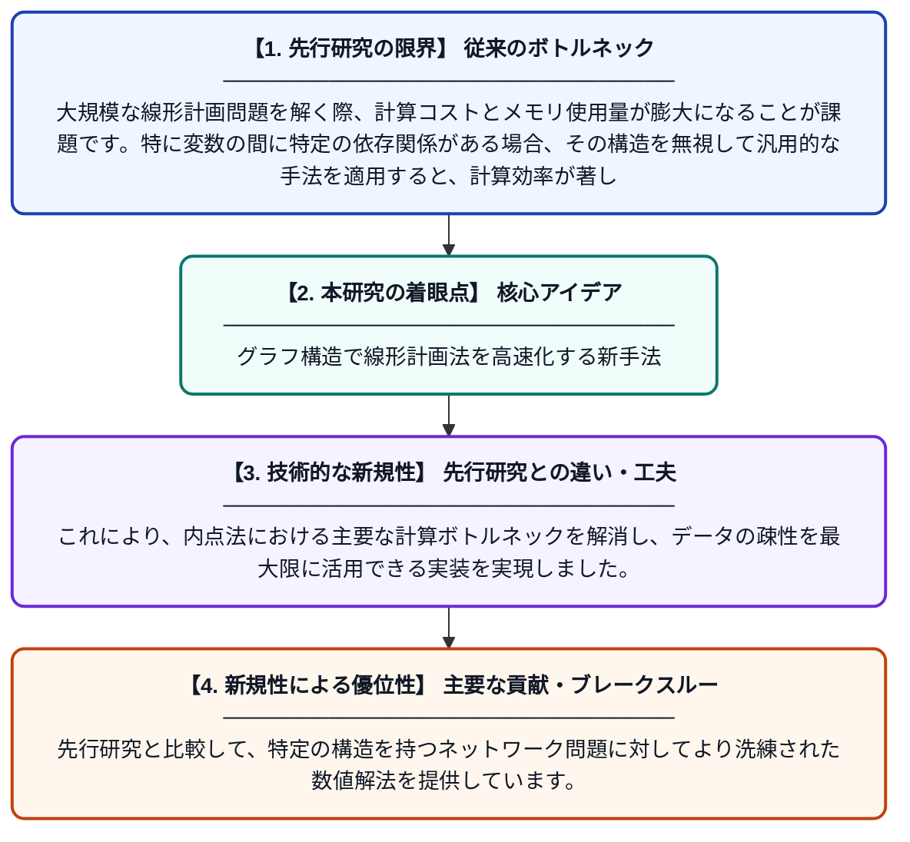

# グラフィカルモデル形式における線形計画最適化問題を解決するための内点法の実装

**Original Title**: *IMPLEMENTATION OF INTERIOR-POINT METHOD FOR SOLVING LINEAR PROGRAMING OPTIMIZATION PROBLEM IN FORM OF GRAPHICAL MODEL AND …*

> **💡 一言要約**: グラフ構造で線形計画法を高速化する新手法

| 項目 | 内容 |
|---|---|
| **著者** | I Hornjak |
| **掲載誌** | 2026 |
| **アラートキーワード** | Markov random"  fields |
| **PDF** | [https://matematika.pmf.uns.ac.rs/wp-content/uploads/2026/10/Implementation-of-interior-point-method-for-solving-linear-programing-optimization-problem-in-form-of-graphical-model-and-belief-propagation-algorithm.pdf](https://matematika.pmf.uns.ac.rs/wp-content/uploads/2026/10/Implementation-of-interior-point-method-for-solving-linear-programing-optimization-problem-in-form-of-graphical-model-and-belief-propagation-algorithm.pdf) |
| **原文リンク** | [https://matematika.pmf.uns.ac.rs/wp-content/uploads/2026/10/Implementation-of-interior-point-method-for-solving-linear-programing-optimization-problem-in-form-of-graphical-model-and-belief-propagation-algorithm.pdf](https://matematika.pmf.uns.ac.rs/wp-content/uploads/2026/10/Implementation-of-interior-point-method-for-solving-linear-programing-optimization-problem-in-form-of-graphical-model-and-belief-propagation-algorithm.pdf) |
| **PDF版要約** | [README.pdf](./README.pdf) |

---

## 📊 新規性の図解（先行研究との違いと本研究のブレークスルー）

## 📝 要約

線形計画問題をガウス型マルコフ確率場（GMRF）などのグラフィカルモデルとして表現し、内点法を用いて効率的に解く手法を提案しています。特に無向グラフ構造を利用した行列の因数分解により、大規模かつスパースな最適化問題の計算効率を向上させています。

## ❓ どんな問題に取り組んだか

大規模な線形計画問題を解く際、計算コストとメモリ使用量が膨大になることが課題です。特に変数の間に特定の依存関係がある場合、その構造を無視して汎用的な手法を適用すると、計算効率が著しく低下するという問題がありました。

## ✨ 何が新しい？何がすごい？（新規性）

線形計画問題を「ガウス型マルコフ確率場」というグラフィカルモデルの枠組みで捉え直し、グラフの接続関係に基づいた因数分解（ factorization）を導入した点が画期的です。これにより、内点法における主要な計算ボトルネックを解消し、データの疎性を最大限に活用できる実装を実現しました。先行研究と比較して、特定の構造を持つネットワーク問題に対してより洗練された数値解法を提供しています。

## 🎓 大学1年生向けの解説

「多くの制約の中で最も良い答えを見つける」ための数学（線形計画法）を、点と線で描かれた図（グラフ）の考え方を使って速く解くための研究です。例えば、たくさんの場所を結ぶ配送ルートの計算のように、関係性が複雑な問題を効率よく解くことができます。難しい計算を、図の形に注目して整理することで、コンピュータが楽に処理できるように工夫されています。
