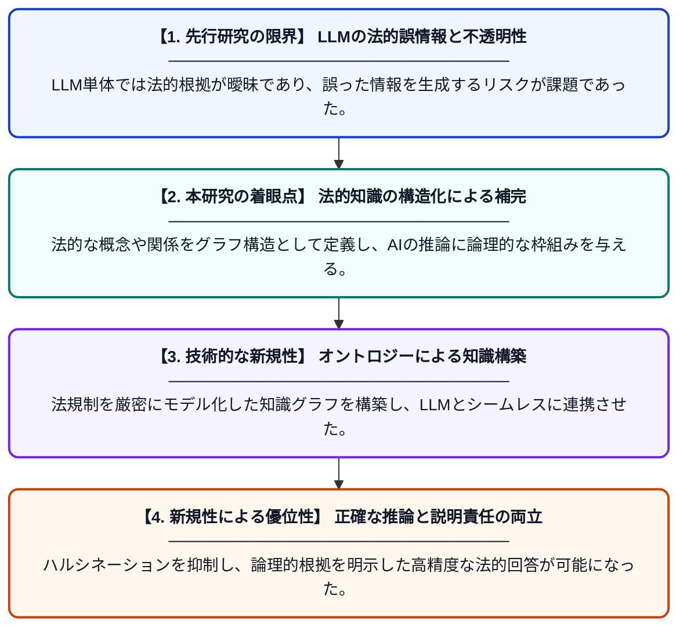

# オントロジーベースの知識グラフを用いたLLMによる法的推論の向上

**Original Title**: *Legal Reasoning in LLMs Through Ontology-Based Knowledge Graphs*

> **💡 一言要約**: 知識グラフでLLMの法的誤回答を防ぎ、根拠を可視化

| 項目 | 内容 |
|---|---|
| **著者** | DV Dang, DH Tran, TNL Bui, VT Pham, HQ Ngo… |
| **掲載誌** | International Conference on … 2026 |
| **アラートキーワード** | Ontology |
| **原文リンク** | [https://link.springer.com/chapter/10.1007/978-981-92-7408-6_32](https://link.springer.com/chapter/10.1007/978-981-92-7408-6_32) |
| **PDF版要約** | [README.pdf](./README.pdf) |

---

## 📊 新規性の図解（先行研究との違いと本研究のブレークスルー）

## 📝 要約

大規模言語モデル（LLM）が法律分野で直面する「ハルシネーション（もっともらしい嘘）」や「推論プロセスの不透明性」を解決する手法を提案しています。法的な概念を構造化したオントロジーに基づく知識グラフを活用することで、正確かつ根拠の明快な法的推論を実現しています。

## ❓ どんな問題に取り組んだか

法律実務においてLLMを利用する際、不正確な法律解釈を生成したり、結論に至る論理的根拠が不明確であったりすることが大きな障壁となっています。特に複雑な法規制が絡む場合、既存のモデルでは法的な論理構造を正確に反映した回答が困難でした。

## ✨ 何が新しい？何がすごい？（新規性）

本研究の新規性は、法的概念の関係性を厳密に定義した「オントロジーベースの知識グラフ」をLLMの推論に統合した点にあります。従来のテキスト検索による補助（RAG）とは異なり、法律の論理構造そのものをグラフ形式で保持することで、法規間の複雑な依存関係を正確に考慮した推論が可能になりました。これにより、ハルシネーションを大幅に抑制し、かつ推論ステップの透明性を高めることに成功しています。

## 🎓 大学1年生向けの解説

AIに法律の質問をすると、時々もっともらしい嘘をついてしまうことがあります。この研究では、法律のルールや専門用語を「正しいつながりを持った地図（知識グラフ）」として整理し、AIがその地図を確認しながら答えを導き出す仕組みを作りました。これにより、AIが嘘をつくのを防ぎ、さらに「なぜその答えになったのか」という理由も分かりやすく説明できるようになります。法律のプロが使うような厳密な考え方を、AIに身につけさせるための画期的な方法です。
