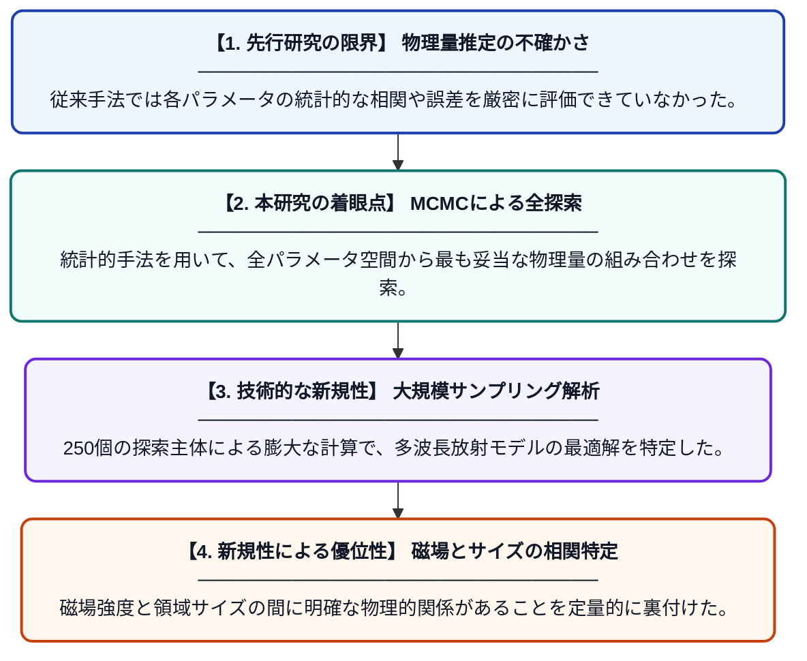

# 高シンクロトロン・ピーク型BL Lac型天体Mrk 421における磁場強度と放射領域サイズの相関関係

**Original Title**: *The Relation between Magnetic-field Intensity and Size of the Emission Region in the High-synchrotron-peaked BL Lacertae Object Mrk 421*

> **💡 一言要約**: Mrk 421の磁場と領域サイズの相関をMCMCで特定

| 項目 | 内容 |
|---|---|
| **著者** | YB Xu, YG Zheng, L Zhang |
| **掲載誌** | The Astrophysical Journal 2026 |
| **アラートキーワード** | MCMC |
| **PDF** | [https://iopscience.iop.org/article/10.3847/1538-4357/aea615/pdf](https://iopscience.iop.org/article/10.3847/1538-4357/aea615/pdf) |
| **原文リンク** | [https://iopscience.iop.org/article/10.3847/1538-4357/aea615/pdf](https://iopscience.iop.org/article/10.3847/1538-4357/aea615/pdf) |
| **PDF版要約** | [README.pdf](./README.pdf) |

---

## 📊 新規性の図解（先行研究との違いと本研究のブレークスルー）

## 📝 要約

活動銀河核Mrk 421を対象に、MCMC（マルコフ連鎖モンテカルロ法）を用いて放射領域の物理パラメータを精密に推定しました。特に磁場強度と放射領域サイズの間に存在する物理的な相関関係を統計的に明らかにし、高エネルギー放射メカニズムの理解を深めました。

## ❓ どんな問題に取り組んだか

巨大ブラックホールから噴き出すジェットの放射メカニズムにおいて、磁場強度や放射領域のサイズといった物理量を正確に推定することは困難でした。特に、これらのパラメータ間の相互依存性や不確実性を定量的に評価する統計的手法が不足していました。

## ✨ 何が新しい？何がすごい？（新規性）

本研究は、250個のウォーカーと2000ステップに及ぶ大規模なMCMCサンプリングを採用することで、多波長スペクトルに対する物理パラメータの信頼区間を厳密に算出しました。従来の解析では見落とされがちだった磁場強度、ドップラー因子、および放射領域半径の間の複雑な相関を可視化しています。これにより、Mrk 421の放射環境をより物理的妥当性の高いモデルで記述することに成功しました。

## 🎓 大学1年生向けの解説

遠くの宇宙にある「活動銀河核」という非常に明るい天体からは、光速に近いスピードでガスが噴き出しています。この研究では、Mrk 421という有名な天体が出す光を分析して、そのガスの中にある「磁石の力（磁場）」と「光っている場所の大きさ」がどのような関係にあるかを調べました。膨大な回数のシミュレーションを繰り返すことで、これまで曖昧だった数値の組み合わせを高い精度で突き止めています。これにより、宇宙の巨大なエンジンがどのようにエネルギーを生み出しているのかを知る重要な手がかりが得られました。
