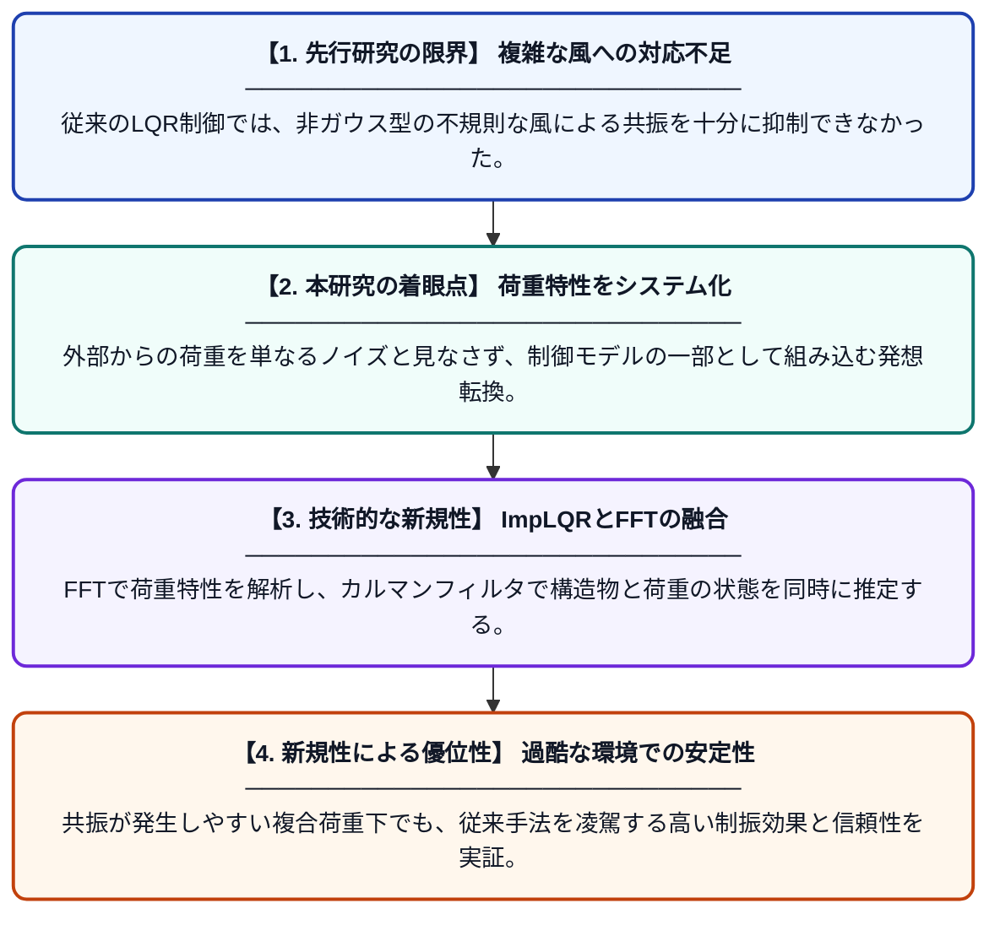

# 非ガウス型共振強制複合荷重下の構造物に対するカルマンフィルタ強化型LQR：陸上風力発電機への応用

**Original Title**: *Kalman-filter-enhanced LQR for structures under non-Gaussian resonant-forced composite loading: application to an onshore operating wind turbine*

> **💡 一言要約**: 風の乱れを予測し、風力発電機の揺れを最適に抑える

| 項目 | 内容 |
|---|---|
| **著者** | Y Yang, Q Yang, Q Wang, T Long, J Cui, T Li |
| **掲載誌** | Engineering Structures 2027 |
| **アラートキーワード** | kalman filter |
| **原文リンク** | [https://www.sciencedirect.com/science/article/pii/S0141029626020572](https://www.sciencedirect.com/science/article/pii/S0141029626020572) |
| **PDF版要約** | [README.pdf](./README.pdf) |

---

## 📊 新規性の図解（先行研究との違いと本研究のブレークスルー）

## 📝 要約

複雑な非ガウス型荷重を受ける風力発電機の振動抑制を目的として、カルマンフィルタを組み込んだ改良型LQR（ImpLQR）が開発されました。荷重特性をサブシステムとして構造モデルに統合することで、従来の制御手法では困難だった共振を伴う過酷な環境下での高い制振性能を実現しています。

## ❓ どんな問題に取り組んだか

風力発電機は常に不規則で複雑な風荷重（非ガウス荷重）にさらされており、これが引き起こす共振は構造的な損傷の原因となります。しかし、従来のLQR（線形二乗レギュレータ）制御では、このような予測困難な外部荷重の変化に対してリアルタイムで最適に追従し、振動を抑え込むことが難しいという課題がありました。

## ✨ 何が新しい？何がすごい？（新規性）

本研究の最大の特徴は、荷重側の特性を記述するサブシステムを構造物自体の状態方程式に統合した「ImpLQR」を提案した点にあります。高速フーリエ変換（FFT）と半値幅法を駆使して荷重側の特性行列を正確に特定し、カルマンフィルタで状態を推定することで、外乱の影響を「予測」に取り込むことに成功しました。これにより、先行研究では対応できなかった非ガウス型かつ共振を誘発する複合荷重に対して、圧倒的な制振精度を達成しています。

## 🎓 大学1年生向けの解説

風力発電機の巨大な塔は、複雑に変化する風を受けて常に揺れています。この揺れを放置すると故障の原因になりますが、風は気まぐれなので、いつ・どのくらいの力で揺れるかを予測して抑えるのは至難の業です。この論文では、風の性質を数学的に分析し、揺れを止める装置（制御システム）に「未来の風の動き」を教え込む新しい方法を開発しました。これにより、どんなに不規則な強風が吹いても、発電機をピタッと安定させることができるようになります。
