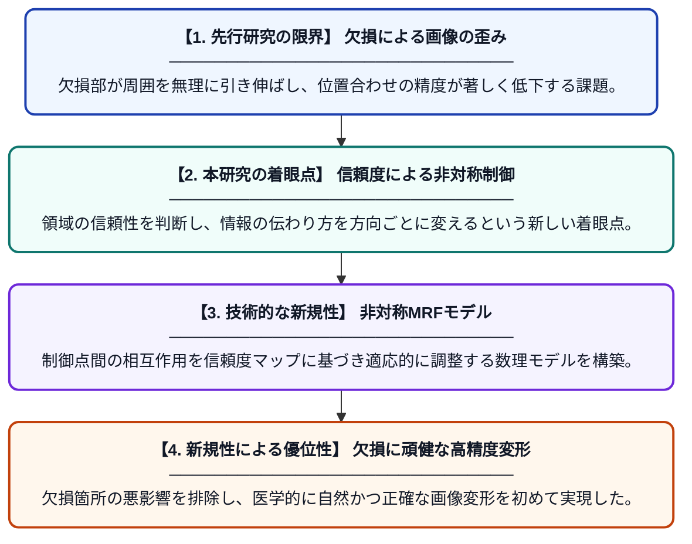

# 欠損領域を含む医用画像のための非対称MRFを用いた非剛体画像レジストレーション

**Original Title**: *Asymmetric MRF-based Non-Rigid Image Registration for Medical Images with Missing Regions*

> **💡 一言要約**: 欠損に負けない！非対称MRFで賢く画像を位置合わせ

| 項目 | 内容 |
|---|---|
| **著者** | S Nobata, T Tokunaga |
| **掲載誌** | Nonlinear Theory and Its Applications, IEICE 2026 |
| **アラートキーワード** | MRFs Markov |
| **PDF** | [https://www.jstage.jst.go.jp/article/nolta/advpub/0/advpub_2026NHP0008/_pdf](https://www.jstage.jst.go.jp/article/nolta/advpub/0/advpub_2026NHP0008/_pdf) |
| **原文リンク** | [https://www.jstage.jst.go.jp/article/nolta/advpub/0/advpub_2026NHP0008/_pdf](https://www.jstage.jst.go.jp/article/nolta/advpub/0/advpub_2026NHP0008/_pdf) |
| **PDF版要約** | [README.pdf](./README.pdf) |

---

## 📊 新規性の図解（先行研究との違いと本研究のブレークスルー）

## 📝 要約

欠損箇所がある医用画像において、制御点間の相互作用を信頼度に応じて適応的に調整する非対称マルコフ確率場（MRF）を用いた新しい画像位置合わせ手法を提案しています。欠損領域による不自然な歪みを抑えつつ、正確な画像変形を実現することが可能になりました。

## ❓ どんな問題に取り組んだか

医用画像解析において、手術による切除や撮影範囲の制限などで画像の一部が欠損している場合、従来の技術では欠損箇所が周囲を無理に引き込んでしまい、画像が不自然に歪むという課題がありました。この歪みは、診断や治療計画の精度を著しく低下させる原因となっていました。

## ✨ 何が新しい？何がすごい？（新規性）

本研究の最大の特徴は、従来の対称的な制御点間の関係を打破し、情報の信頼度に基づいた「非対称な」相互作用を導入した点にあります。欠損の有無に応じて情報の伝達強度を動的に制御することで、信頼できる領域から欠損部への予測を可能にしつつ、欠損部からの誤った影響を遮断する仕組みを構築しました。これにより、従来手法では困難だった大規模な欠損を含む画像に対しても、破綻のない高精度な変形推定に成功しました。

## 🎓 大学1年生向けの解説

2枚の画像をぴったり重ね合わせる際、片方の画像に「穴」が空いていると、その穴に引きずられて画像全体がぐにゃりと歪んでしまう問題がありました。この研究では、画像の中に「怪しい場所（穴）」があることを検知し、その場所からの影響を弱める特別な計算方法を開発しました。例えるなら、パズルの欠けている部分を、周りの正しいピースの形から上手に予測して埋めるような技術です。これによって、データが不完全な画像でも正確に分析できるようになりました。
