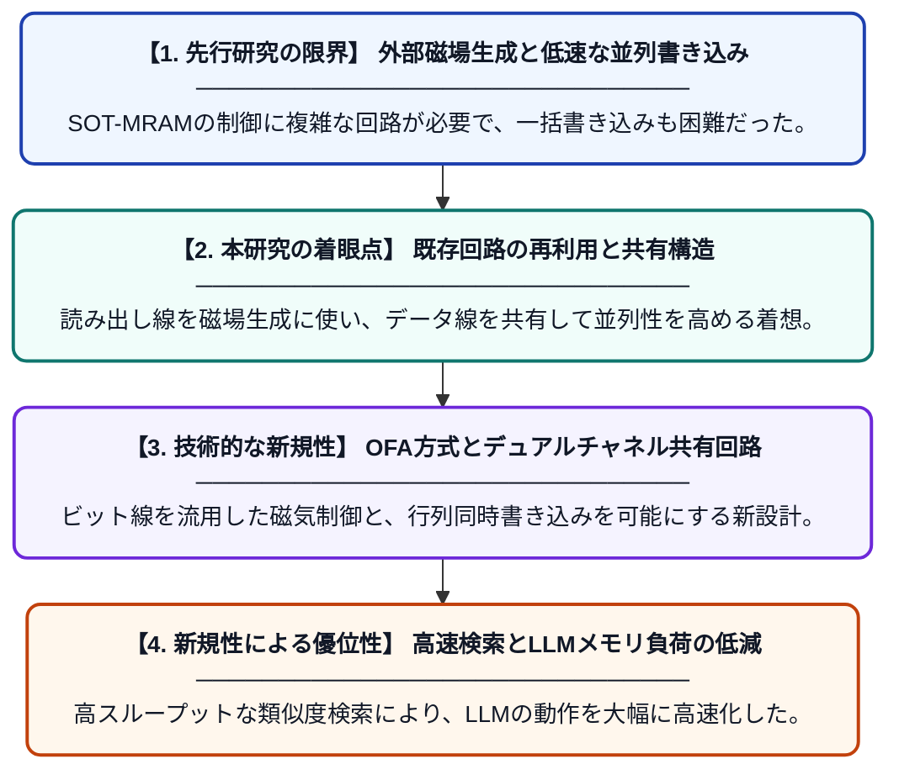

# LLMのKVキャッシュ圧縮における高スループットなバイナリ類似度検索に向けた、デュアルチャネル共有OFA-p-SOT-MRAM CIMマクロ

**Original Title**: *Dual-channel-shared OFA-p-SOT-MRAM CIM Macro for High-throughput Binary Similarity Search in LLM KV-Cache Compression*

> **💡 一言要約**: メモリ内でLLMの高速検索を可能にする新型MRAM

| 項目 | 内容 |
|---|---|
| **著者** | F Gao, C Xiao, D Jiang, X Tang, J Zhao, T Yang, J Tang… |
| **掲載誌** | IEEE 8th International … 2026 |
| **アラートキーワード** | one shot |
| **原文リンク** | [https://ieeexplore.ieee.org/abstract/document/11761794/](https://ieeexplore.ieee.org/abstract/document/11761794/) |
| **PDF版要約** | [README.pdf](./README.pdf) |

---

## 📊 新規性の図解（先行研究との違いと本研究のブレークスルー）

## 📝 要約

大規模言語モデル（LLM）のKVキャッシュ圧縮を効率化するため、SOT-MRAMを用いたメモリ内演算（CIM）技術を提案しています。読み出しビット線を再利用して書き込みを制御するOFA方式と、行・列の並列書き込みを可能にする共有チャネル構造により、高速なバイナリ類似度検索を実現します。

## ❓ どんな問題に取り組んだか

LLMの実行には膨大なKVキャッシュが必要でメモリを圧迫しますが、その圧縮に必要な類似度検索は従来の演算では遅延が大きく、電力消費も激しいという課題があります。また、既存のMRAMは書き込みの制御や並列処理に制限がありました。

## ✨ 何が新しい？何がすごい？（新規性）

読み出しビット線を外部磁場生成に転用するOFA（Offset-Field-Assisted）方式を採用し、垂直磁気異方性を持つSOT-MRAMの確実な反転制御を低コストで実現しました。さらに、デュアルチャネル共有構造により、一度に複数箇所の書き込みが可能な「ワンショット並列書き込み」を達成しています。これにより、LLMの圧縮に必要なハッシュ値比較などの類似度検索をメモリ内で超高速に行えるようになりました。

## 🎓 大学1年生向けの解説

AI（ChatGPTなど）が長い文章を扱うとき、過去の情報を「KVキャッシュ」としてメモリに保存しますが、これが多すぎてコンピュータがパンクしてしまいます。この研究では、その情報をコンパクトにまとめる作業を、メモリの中で直接やってしまう新しいタイプのチップ（MRAM）を開発しました。読み出し回路を書き込み補助に使い回す賢い仕組みで、データの検索スピードを劇的に高めています。
