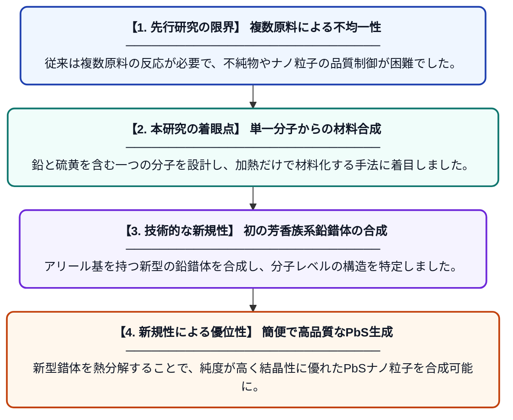

# 鉛(II)ジアリールジチオカルバマート錯体[Pb(S2CNAr2)2]とナノスケールPbSの単一源前駆体としての利用

**Original Title**: *Lead (II) diaryl-dithiocarbamate complexes [pb (S2CNAr2) 2] and their use as single source precursors for nanoscale PbS*

> **💡 一言要約**: 新型の鉛錯体で高品質な硫化鉛ナノ粒子を簡単に合成

| 項目 | 内容 |
|---|---|
| **著者** | MN Hossen, P Mojumdar, M Kundar, PS Roy, MA Alim… |
| **掲載誌** | Inorganica Chimica Acta 2026 |
| **アラートキーワード** | ICA |
| **原文リンク** | [https://www.sciencedirect.com/science/article/pii/S0020169326004469](https://www.sciencedirect.com/science/article/pii/S0020169326004469) |
| **PDF版要約** | [README.pdf](./README.pdf) |

---

## 📊 新規性の図解（先行研究との違いと本研究のブレークスルー）

## 📝 要約

本研究では、初めての例となる鉛(II)ジアリールジチオカルバマート錯体を合成し、その分子構造を詳細に解明しました。この錯体は、高品質な硫化鉛（PbS）ナノ材料を熱分解によって作製するための「単一源前駆体（SSP）」として極めて有効であることを示しました。

## ❓ どんな問題に取り組んだか

硫化鉛ナノ材料の合成において、従来は複数の原料を精密に混合・制御する必要があり、不純物の混入や結晶性のばらつきが課題でした。また、特定の構造を持つ鉛のジアリール系錯体はこれまで報告がなく、その化学的性質や材料への応用可能性が未解明でした。

## ✨ 何が新しい？何がすごい？（新規性）

本研究は、鉛とジアリールジチオカルバマートを組み合わせた新しい錯体を初めて開発し、その単結晶X線構造解析に成功しました。先行研究で主流だった脂肪族系（アルキル基）の錯体と異なり、芳香環（アリール基）を導入することで、熱分解挙動や溶解性を精密に制御できるようになりました。これにより、単一の分子を加熱するだけで高品質なPbSナノ結晶が得られる「単一源前駆体」としての有用性を実証した点が画期的です。

## 🎓 大学1年生向けの解説

「硫化鉛」は光センサーや太陽電池に使われる非常に重要な材料ですが、とても小さなナノサイズできれいに作るのは大変です。この研究では、鉛と硫黄が最初からセットになった「特製の分子（錯体）」を新しく開発しました。この分子を熱するだけで、まるで魔法のように高品質な硫化鉛の粒が自動的に出来上がります。難しい手順を省いて、高性能な電子材料をシンプルに作れる道を開いた研究です。
