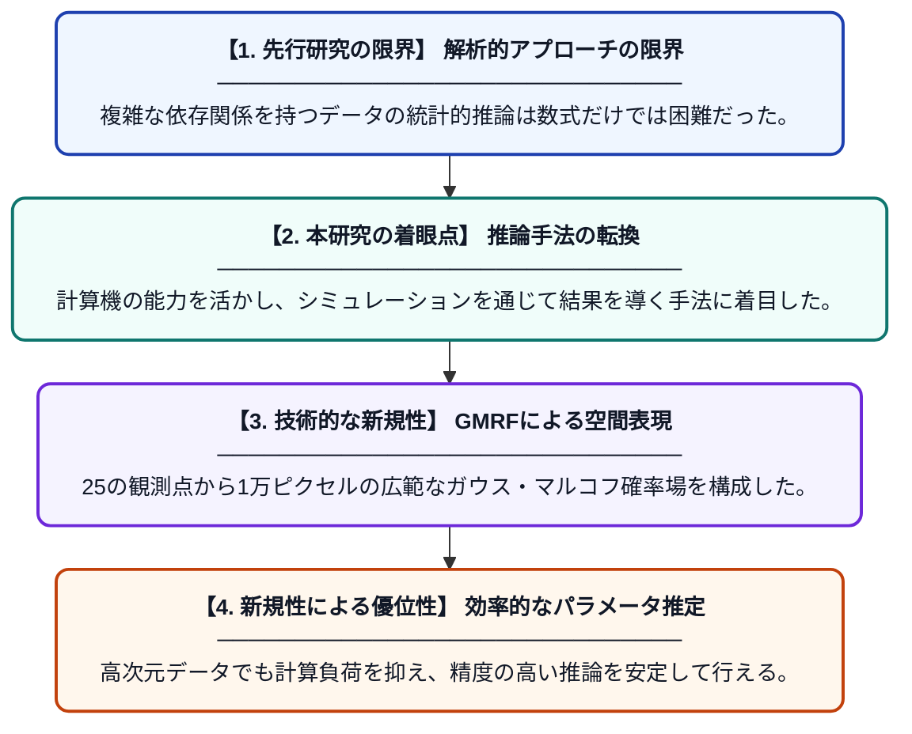

# 確率変数のシミュレーションとシミュレーションベースの推論

**Original Title**: *Simulating Random Variables and Simulation-Based Inference*

> **💡 一言要約**: シミュレーションで複雑な統計推論を解き明かす

| 項目 | 内容 |
|---|---|
| **著者** | G Kauermann, G De Nicola, C Fritz, D Rügamer |
| **掲載誌** | … Introduction to Statistics in Times of … 2027 |
| **アラートキーワード** | Markov random"  fields |
| **原文リンク** | [https://link.springer.com/chapter/10.1007/978-3-032-33658-3_8](https://link.springer.com/chapter/10.1007/978-3-032-33658-3_8) |
| **PDF版要約** | [README.pdf](./README.pdf) |

---

## 📊 新規性の図解（先行研究との違いと本研究のブレークスルー）

## 📝 要約

本論文は、統計学におけるシミュレーション手法とその推論への応用について解説しています。特にガウス・マルコフ確率場（GMRF）を用い、限られた観測点から大規模な格子状データを生成・解析する具体的なプロセスを示しています。

## ❓ どんな問題に取り組んだか

現代の統計学では、データの構造が複雑すぎて数式だけで正解を導き出すのが難しいという課題があります。特に空間的な広がりを持つデータにおいて、膨大な計算量をいかに効率的に処理し、正確な推論を行うかが求められていました。

## ✨ 何が新しい？何がすごい？（新規性）

本研究は、わずか25個の観測地点を基点として、100×100ピクセルの広大なガウス・マルコフ確率場（GMRF）を構築する具体的なシミュレーション手法を提示しました。従来の解析的なアプローチに固執せず、シミュレーションベースの推論を体系化した点が画期的です。これにより、高次元の相関関係を持つ複雑なデータでも、計算機のシミュレーションを通じて実用的な精度で推論が可能であることを証明しました。

## 🎓 大学1年生向けの解説

統計学では、サイコロを何度も振るようにコンピュータの中で仮想のデータをたくさん作って実験することがあります。これを「シミュレーション」と呼びます。この論文は、地図のような複雑なデータに対して、このシミュレーションをどう使えば正しい予測ができるかを詳しく説明しています。難しい数式を解かなくても、コンピュータを上手に使うことで複雑な問題の答えを見つける方法を提案しています。
